# Benchmarks

<!-- AUTO-GENERATED by `cargo xtask render-speed`; do not edit by hand. Unlike docs/support.md there is no freshness test: timings are not reproducible byte-for-byte, so this file is a dated measurement, not a compared snapshot. -->

Measured performance of dewasm-generated code, taken on one host on one day.
It is compared against wasm runtimes and same-language wasm interpreters.
How to run and read these measurements is [README.md](README.md).

## Environment

Measured 2026-11-20T14:58:01Z.

| | |
| --- | --- |
| OS | macOS 27.2.1 |
| Kernel | Darwin 27.2.0 |
| CPU | Apple M1 Pro |
| Architecture | aarch64 |

Version strings are captured by executing each runtime.
A runner missing from this table was unavailable on this host; its cells appear under [Not measured](#not-measured).

| Runner | Version |
| --- | --- |
| `wasmtime` | `wasmtime 50.0.2 (f9a93b049 2026-11-16)` |
| `wasmer` | `wasmer 7.5.0` |
| `wasmedge` | `wasmedge version 0.18.1` |
| `wazero` | `1.12.0` |
| `wasm3` | `Wasm3 v0.9.1-beta.1 on arm64-v8a` |
| `dewasm-ruby` | `ruby 4.0.10 (2026-11-19 revision a704b7cd95) +PRISM [arm64-darwin27]` |
| `dewasm-ruby-yjit` | `ruby 4.0.10 (2026-11-19 revision a704b7cd95) +PRISM [arm64-darwin27]` |
| `dewasm-ruby-zjit` | `ruby 4.0.10 (2026-11-19 revision a704b7cd95) +PRISM [arm64-darwin27]` |
| `dewasm-monoruby` | `monoruby 0.3.0 (revision a9120befc2) [arm64-darwin25]` |
| `dewasm-jruby` | `jruby 10.1.3.0 (4.0.9) 2026-11-05 3db52d02f9 OpenJDK 64-Bit Server VM 25.0.5+8-LTS on 25.0.5+8-LTS +indy +jit [arm64-darwin]` |
| `dewasm-spinel` | `spinel 2026.10.25+6767 (89d6ebc58) [apple clang 21.0.0 (cc)]` |
| `dewasm-python` | `Python 3.15.2 (main, Oct 26 2026, 13:59:33) [Clang 23.1.3 ]` |
| `dewasm-python-jit` | `Python 3.15.2 (main, Oct 26 2026, 13:59:33) [Clang 23.1.3 ]` |
| `dewasm-pypy` | `Python 3.11.17 (ec82f20141cf, Oct 20 2026, 22:34:40)` |
| `dewasm-graalpy` | `GraalPy 3.13.14 (Oracle GraalVM Native 25.5.5.0.3)` |
| `dewasm-perl` | `v5.44.0` |
| `dewasm-go` | `go version go1.27.4 darwin/arm64` |
| `dewasm-tinygo` | `tinygo version 0.44.0 darwin/arm64 (using go version go1.27.4 and LLVM version 22.1.4)` |
| `dewasm-java` | `openjdk version "25.0.5" 2026-10-20 LTS` |
| `dewasm-codon` | `0.20.7` |
| `dewasm-bash` | `5.3.20(1)-release` |
| `wasm3-ruby` | `Wasm3 v0.9.0 on wasm` |
| `wasm3-ruby-yjit` | `Wasm3 v0.9.0 on wasm` |
| `wasm3-python` | `Wasm3 v0.9.0 on wasm` |
| `wasm3-pypy` | `Wasm3 v0.9.0 on wasm` |
| `pywasm-cpython` | `pywasm 2.2.3` |
| `pywasm-pypy` | `pywasm 2.2.3` |
| `wardite` | `wardite 1.3.1` |
| `wardite-yjit` | `wardite 1.3.1` |

## Results

Each workload has a chart with its full numbers folded underneath.
A chart has a log axis in seconds, and its title states the unit.
Color is the runner family.

### Microbenchmarks

Seconds per **iteration**.
Iteration counts are calibrated per runner.
So compare the per-iteration figures, not the raw wall times.

#### `wat/br_table`

<picture>
  <source media="(prefers-color-scheme: dark)" srcset="figs/wat-br-table-dark.svg">
  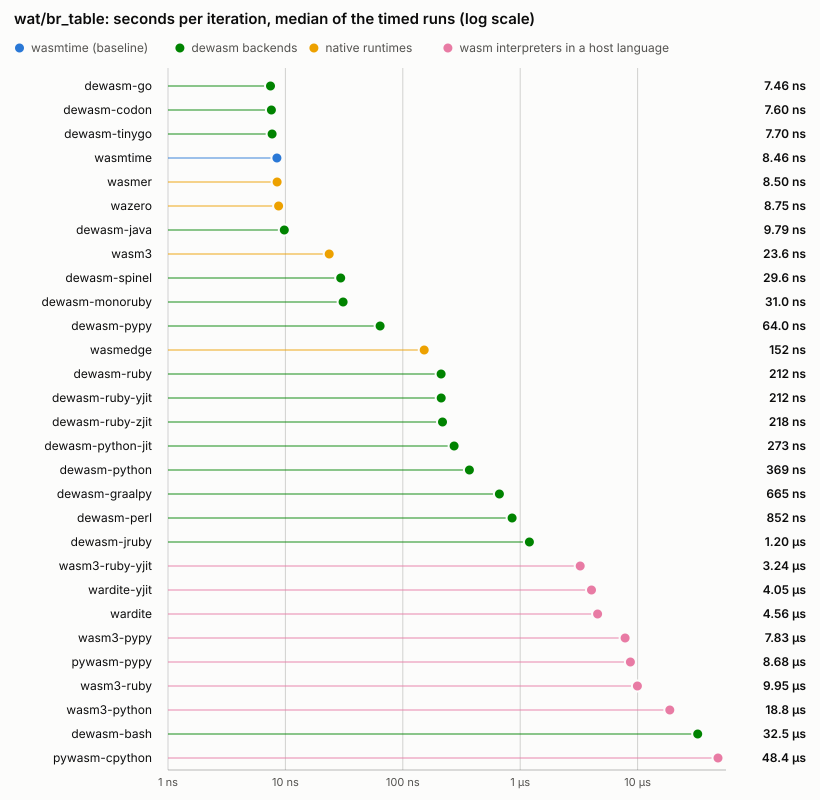
</picture>

Full numbers for <code>wat/br_table</code>

| Runner | Iterations | Minimum `ns/op` | Median `ns/op` | Cold start `t(0)` | Total `t(N)` | vs. `wasmtime` | Load |
| --- | --- | --- | --- | --- | --- | --- | --- |
| `wasmtime` | 35 315 539 | 8.45 | 8.46 | 5.7 ms | 304.2 ms | 1.00x | — |
| `wasmer` | 34 919 289 | 8.46 | 8.50 | 9.0 ms | 304.3 ms | 1.00x | — |
| `wasmedge` | 2 154 774 | 150.4 | 152.0 | 22.3 ms | 346.5 ms | 18x | — |
| `wazero` | 33 820 022 | 8.74 | 8.75 | 5.8 ms | 301.3 ms | 1.03x | — |
| `wasm3` | 10 760 753 | 23.4 | 23.6 | 7.0 ms | 259.2 ms | 2.77x | — |
| `dewasm-ruby` | 1 304 509 | 211.5 | 211.9 | 35.5 ms | 311.5 ms | 25x | — |
| `dewasm-ruby-yjit` | 1 242 601 | 212.0 | 212.1 | 35.0 ms | 298.4 ms | 25x | — |
| `dewasm-ruby-zjit` | 1 275 770 | 214.5 | 217.6 | 34.9 ms | 308.5 ms | 25x | — |
| `dewasm-monoruby` | 9 712 096 | 31.0 | 31.0 | 34.0 ms | 334.8 ms | 3.66x | — |
| `dewasm-jruby` | 198 028 | 1175 | 1197 | 1.30 s | 1.53 s | 139x | — |
| `dewasm-spinel` | 9 452 121 | 29.3 | 29.6 | 2.4 ms | 279.3 ms | 3.47x | — |
| `dewasm-python` | 798 279 | 369.2 | 369.2 | 18.1 ms | 312.9 ms | 44x | — |
| `dewasm-python-jit` | 885 827 | 272.8 | 273.3 | 18.3 ms | 260.0 ms | 32x | — |
| `dewasm-pypy` | 4 226 037 | 63.7 | 64.0 | 39.2 ms | 308.5 ms | 7.54x | — |
| `dewasm-graalpy` | 372 569 | 661.0 | 664.9 | 47.1 ms | 293.4 ms | 78x | — |
| `dewasm-perl` | 343 053 | 852.3 | 852.2 | 44.2 ms | 336.6 ms | 101x | — |
| `dewasm-go` | 40 171 290 | 7.46 | 7.46 | 2.4 ms | 302.1 ms | 0.88x | — |
| `dewasm-tinygo` | 39 634 443 | 7.58 | 7.70 | 1.8 ms | 302.1 ms | 0.90x | — |
| `dewasm-java` | 26 919 092 | 9.74 | 9.79 | 49.8 ms | 312.0 ms | 1.15x | — |
| `dewasm-codon` | 39 608 062 | 7.60 | 7.60 | 12.5 ms | 313.5 ms | 0.90x | — |
| `dewasm-bash` | 8 264 | 32462 | 32515 | 11.5 ms | 279.7 ms | 3840x | — |
| `wasm3-ruby` | 27 196 | 9909 | 9952 | 113.7 ms | 383.2 ms | 1172x | — |
| `wasm3-ruby-yjit` | 104 290 | 3193 | 3245 | 292.6 ms | 625.5 ms | 378x | — |
| `wasm3-python` | 15 092 | 19759 | 18808 | 301.6 ms | 599.8 ms | 2338x | — |
| `wasm3-pypy` | 28 914 | 6983 | 7832 | 459.2 ms | 661.1 ms | 826x | — |
| `pywasm-cpython` | 6 000 | 48611 | 48389 | 27.4 ms | 319.1 ms | 5751x | 0.8 ms |
| `pywasm-pypy` | 22 167 | 8617 | 8684 | 73.0 ms | 264.0 ms | 1019x | 4.5 ms |
| `wardite` | 66 316 | 4553 | 4563 | 57.6 ms | 359.5 ms | 539x | 3.7 ms |
| `wardite-yjit` | 77 133 | 3831 | 4049 | 149.2 ms | 444.7 ms | 453x | 40.9 ms |

#### `wat/call_direct`

<picture>
  <source media="(prefers-color-scheme: dark)" srcset="figs/wat-call-direct-dark.svg">
  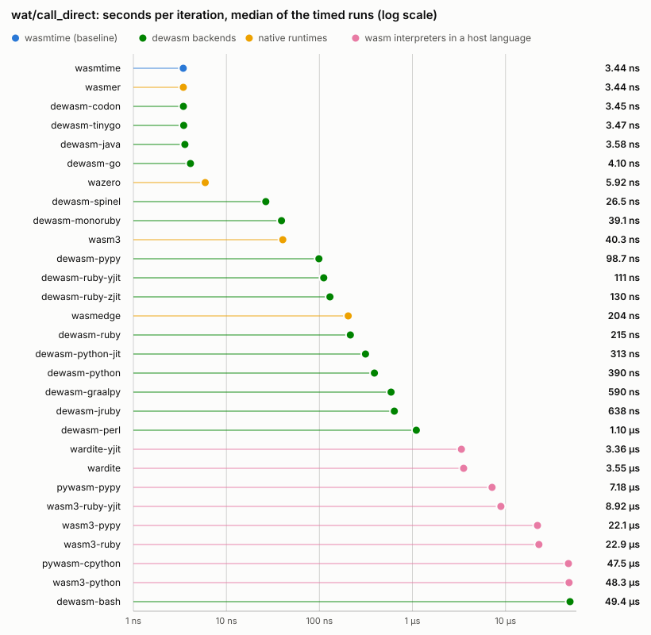
</picture>

Full numbers for <code>wat/call_direct</code>

| Runner | Iterations | Minimum `ns/op` | Median `ns/op` | Cold start `t(0)` | Total `t(N)` | vs. `wasmtime` | Load |
| --- | --- | --- | --- | --- | --- | --- | --- |
| `wasmtime` | 87 302 014 | 3.42 | 3.44 | 5.2 ms | 304.1 ms | 1.00x | — |
| `wasmer` | 86 238 062 | 3.44 | 3.44 | 8.8 ms | 305.3 ms | 1.00x | — |
| `wasmedge` | 1 458 241 | 204.1 | 204.0 | 19.5 ms | 317.2 ms | 60x | — |
| `wazero` | 50 819 087 | 5.91 | 5.92 | 6.1 ms | 306.4 ms | 1.73x | — |
| `wasm3` | 7 326 551 | 40.1 | 40.3 | 6.8 ms | 300.6 ms | 12x | — |
| `dewasm-ruby` | 944 271 | 216.7 | 215.1 | 35.1 ms | 239.7 ms | 63x | — |
| `dewasm-ruby-yjit` | 2 651 117 | 111.4 | 111.3 | 37.5 ms | 332.8 ms | 33x | — |
| `dewasm-ruby-zjit` | 2 205 449 | 130.2 | 129.8 | 35.3 ms | 322.5 ms | 38x | — |
| `dewasm-monoruby` | 4 713 124 | 39.3 | 39.1 | 35.5 ms | 220.9 ms | 11x | — |
| `dewasm-jruby` | 394 749 | 569.1 | 638.2 | 1.32 s | 1.55 s | 166x | — |
| `dewasm-spinel` | 8 742 018 | 26.5 | 26.5 | 2.1 ms | 233.6 ms | 7.74x | — |
| `dewasm-python` | 773 207 | 386.2 | 390.3 | 18.1 ms | 316.7 ms | 113x | — |
| `dewasm-python-jit` | 851 593 | 313.6 | 313.1 | 18.6 ms | 285.7 ms | 92x | — |
| `dewasm-pypy` | 1 911 052 | 99.0 | 98.7 | 39.0 ms | 228.2 ms | 29x | — |
| `dewasm-graalpy` | 302 386 | 576.9 | 589.8 | 46.1 ms | 220.6 ms | 169x | — |
| `dewasm-perl` | 270 737 | 1091 | 1101 | 42.0 ms | 337.3 ms | 319x | — |
| `dewasm-go` | 73 696 783 | 4.08 | 4.10 | 2.4 ms | 303.1 ms | 1.19x | — |
| `dewasm-tinygo` | 86 987 297 | 3.44 | 3.47 | 1.8 ms | 300.8 ms | 1.00x | — |
| `dewasm-java` | 94 971 402 | 3.55 | 3.58 | 50.7 ms | 387.4 ms | 1.04x | — |
| `dewasm-codon` | 85 911 863 | 3.45 | 3.45 | 12.5 ms | 308.9 ms | 1.01x | — |
| `dewasm-bash` | 5 055 | 49237 | 49426 | 11.3 ms | 260.2 ms | 14382x | — |
| `wasm3-ruby` | 40 960 | 22794 | 22865 | 116.0 ms | 1.05 s | 6658x | — |
| `wasm3-ruby-yjit` | 21 282 | 8993 | 8924 | 213.9 ms | 405.3 ms | 2627x | — |
| `wasm3-python` | 12 901 | 47199 | 48282 | 309.6 ms | 918.5 ms | 13787x | — |
| `wasm3-pypy` | 10 826 | 21113 | 22084 | 461.5 ms | 690.0 ms | 6167x | — |
| `pywasm-cpython` | 4 858 | 47094 | 47537 | 26.8 ms | 255.6 ms | 13756x | 0.6 ms |
| `pywasm-pypy` | 31 148 | 7456 | 7178 | 75.1 ms | 307.3 ms | 2178x | 2.8 ms |
| `wardite` | 72 286 | 3637 | 3550 | 57.4 ms | 320.3 ms | 1063x | 4.0 ms |
| `wardite-yjit` | 54 260 | 3359 | 3363 | 143.1 ms | 325.4 ms | 981x | 41.4 ms |

#### `wat/call_indirect`

<picture>
  <source media="(prefers-color-scheme: dark)" srcset="figs/wat-call-indirect-dark.svg">
  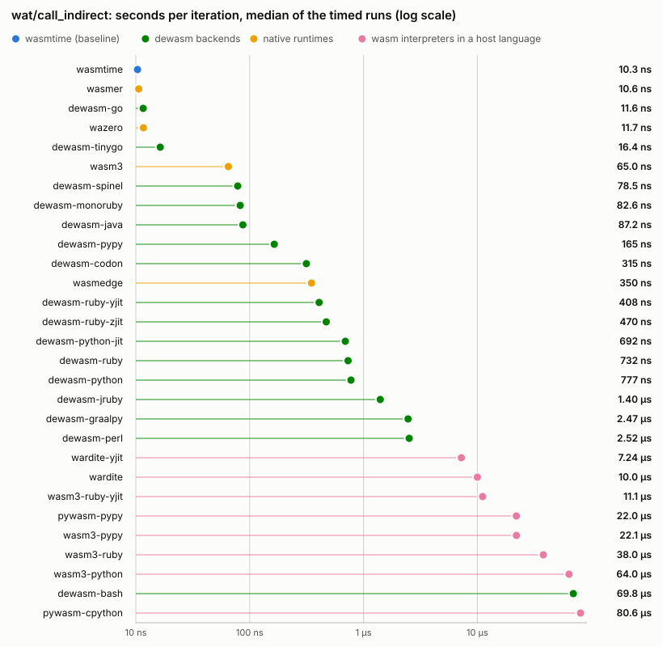
</picture>

Full numbers for <code>wat/call_indirect</code>

| Runner | Iterations | Minimum `ns/op` | Median `ns/op` | Cold start `t(0)` | Total `t(N)` | vs. `wasmtime` | Load |
| --- | --- | --- | --- | --- | --- | --- | --- |
| `wasmtime` | 33 554 432 | 10.3 | 10.3 | 5.3 ms | 352.5 ms | 1.00x | — |
| `wasmer` | 33 554 432 | 10.5 | 10.6 | 8.9 ms | 360.1 ms | 1.01x | — |
| `wasmedge` | 833 187 | 346.0 | 349.7 | 19.5 ms | 307.8 ms | 33x | — |
| `wazero` | 15 599 104 | 11.7 | 11.7 | 5.3 ms | 187.1 ms | 1.13x | — |
| `wasm3` | 4 854 369 | 63.3 | 65.0 | 7.3 ms | 314.4 ms | 6.12x | — |
| `dewasm-ruby` | 379 089 | 731.2 | 732.3 | 35.6 ms | 312.8 ms | 71x | — |
| `dewasm-ruby-yjit` | 441 413 | 407.2 | 407.9 | 34.9 ms | 214.7 ms | 39x | — |
| `dewasm-ruby-zjit` | 590 595 | 461.4 | 470.4 | 36.5 ms | 308.9 ms | 45x | — |
| `dewasm-monoruby` | 3 974 454 | 82.3 | 82.6 | 35.4 ms | 362.6 ms | 7.96x | — |
| `dewasm-jruby` | 95 508 | 1835 | 1403 | 1.32 s | 1.50 s | 177x | — |
| `dewasm-spinel` | 3 820 629 | 78.3 | 78.5 | 2.2 ms | 301.5 ms | 7.57x | — |
| `dewasm-python` | 393 208 | 774.0 | 777.0 | 18.0 ms | 322.3 ms | 75x | — |
| `dewasm-python-jit` | 461 654 | 687.3 | 692.1 | 22.8 ms | 340.1 ms | 66x | — |
| `dewasm-pypy` | 1 226 997 | 162.6 | 164.5 | 43.0 ms | 242.6 ms | 16x | — |
| `dewasm-graalpy` | 90 226 | 2457 | 2465 | 52.7 ms | 274.4 ms | 237x | — |
| `dewasm-perl` | 118 272 | 2510 | 2519 | 47.9 ms | 344.8 ms | 243x | — |
| `dewasm-go` | 16 777 216 | 11.6 | 11.6 | 3.1 ms | 197.8 ms | 1.12x | — |
| `dewasm-tinygo` | 16 508 972 | 16.1 | 16.4 | 2.0 ms | 267.7 ms | 1.56x | — |
| `dewasm-java` | 1 470 190 | 83.5 | 87.2 | 57.4 ms | 180.1 ms | 8.07x | — |
| `dewasm-codon` | 910 476 | 314.0 | 314.9 | 15.0 ms | 300.9 ms | 30x | — |
| `dewasm-bash` | 4 351 | 69285 | 69754 | 12.8 ms | 314.2 ms | 6697x | — |
| `wasm3-ruby` | 6 022 | 35851 | 38032 | 122.4 ms | 338.3 ms | 3465x | — |
| `wasm3-ruby-yjit` | 17 820 | 12506 | 11131 | 275.0 ms | 497.8 ms | 1209x | — |
| `wasm3-python` | 2 125 | 63294 | 63971 | 375.5 ms | 510.0 ms | 6118x | — |
| `wasm3-pypy` | 11 776 | 23311 | 22054 | 512.0 ms | 786.5 ms | 2253x | — |
| `pywasm-cpython` | 2 400 | 80336 | 80650 | 27.4 ms | 220.2 ms | 7765x | 0.7 ms |
| `pywasm-pypy` | 8 400 | 21799 | 21998 | 79.6 ms | 262.7 ms | 2107x | 3.3 ms |
| `wardite` | 24 490 | 10047 | 10010 | 58.6 ms | 304.7 ms | 971x | 3.5 ms |
| `wardite-yjit` | 44 350 | 7220 | 7244 | 141.3 ms | 461.5 ms | 698x | 44.0 ms |

#### `wat/conv`

<picture>
  <source media="(prefers-color-scheme: dark)" srcset="figs/wat-conv-dark.svg">
  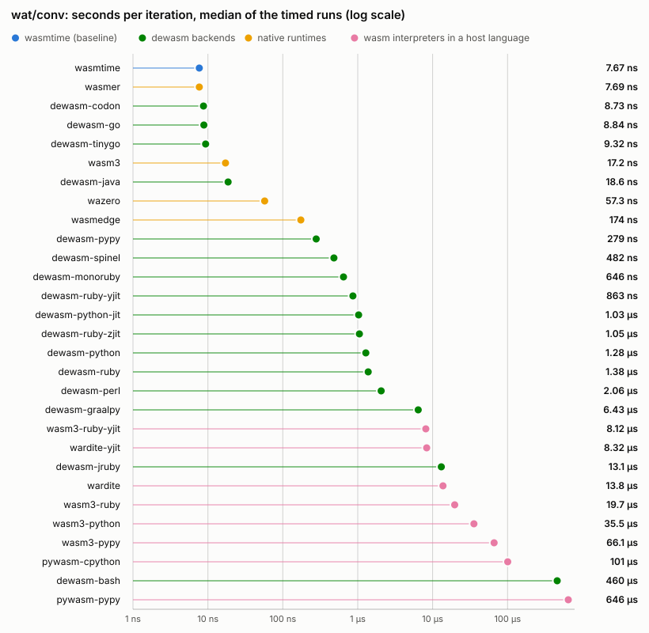
</picture>

Full numbers for <code>wat/conv</code>

| Runner | Iterations | Minimum `ns/op` | Median `ns/op` | Cold start `t(0)` | Total `t(N)` | vs. `wasmtime` | Load |
| --- | --- | --- | --- | --- | --- | --- | --- |
| `wasmtime` | 39 050 395 | 7.68 | 7.67 | 5.2 ms | 304.9 ms | 1.00x | — |
| `wasmer` | 38 642 994 | 7.68 | 7.69 | 8.7 ms | 305.4 ms | 1.00x | — |
| `wasmedge` | 1 635 651 | 173.7 | 173.9 | 20.0 ms | 304.0 ms | 23x | — |
| `wazero` | 5 406 951 | 57.2 | 57.3 | 5.0 ms | 314.4 ms | 7.45x | — |
| `wasm3` | 16 777 216 | 17.2 | 17.2 | 7.0 ms | 295.4 ms | 2.24x | — |
| `dewasm-ruby` | 208 335 | 1365 | 1381 | 36.9 ms | 321.4 ms | 178x | — |
| `dewasm-ruby-yjit` | 295 658 | 860.8 | 863.3 | 37.5 ms | 292.0 ms | 112x | — |
| `dewasm-ruby-zjit` | 210 741 | 1025 | 1053 | 36.2 ms | 252.3 ms | 134x | — |
| `dewasm-monoruby` | 423 657 | 644.0 | 645.8 | 35.1 ms | 308.0 ms | 84x | — |
| `dewasm-jruby` | 16 068 | 13875 | 13068 | 1.32 s | 1.54 s | 1808x | — |
| `dewasm-spinel` | 613 993 | 480.1 | 481.7 | 2.2 ms | 296.9 ms | 63x | — |
| `dewasm-python` | 230 477 | 1273 | 1284 | 18.1 ms | 311.6 ms | 166x | — |
| `dewasm-python-jit` | 274 759 | 1021 | 1027 | 18.6 ms | 299.2 ms | 133x | — |
| `dewasm-pypy` | 1 036 739 | 278.3 | 279.1 | 40.4 ms | 328.9 ms | 36x | — |
| `dewasm-graalpy` | 41 765 | 6352 | 6425 | 48.9 ms | 314.2 ms | 827x | — |
| `dewasm-perl` | 151 895 | 1996 | 2057 | 47.2 ms | 350.4 ms | 260x | — |
| `dewasm-go` | 33 784 211 | 8.84 | 8.84 | 2.4 ms | 300.9 ms | 1.15x | — |
| `dewasm-tinygo` | 33 554 432 | 9.26 | 9.32 | 1.8 ms | 312.5 ms | 1.21x | — |
| `dewasm-java` | 10 291 276 | 18.7 | 18.6 | 51.4 ms | 244.1 ms | 2.44x | — |
| `dewasm-codon` | 34 483 720 | 8.71 | 8.73 | 12.8 ms | 313.0 ms | 1.13x | — |
| `dewasm-bash` | 645 | 460184 | 460117 | 11.6 ms | 308.4 ms | 59949x | — |
| `wasm3-ruby` | 12 648 | 19660 | 19711 | 115.5 ms | 364.1 ms | 2561x | — |
| `wasm3-ruby-yjit` | 30 301 | 8138 | 8116 | 254.2 ms | 500.7 ms | 1060x | — |
| `wasm3-python` | 9 450 | 34982 | 35536 | 307.7 ms | 638.3 ms | 4557x | — |
| `wasm3-pypy` | 2 904 | 64437 | 66098 | 463.3 ms | 650.4 ms | 8394x | — |
| `pywasm-cpython` | 2 840 | 100294 | 100562 | 27.3 ms | 312.1 ms | 13066x | 0.7 ms |
| `pywasm-pypy` | 357 | 652045 | 646287 | 77.1 ms | 309.9 ms | 84944x | 3.0 ms |
| `wardite` | 18 959 | 13774 | 13754 | 59.1 ms | 320.3 ms | 1794x | 4.1 ms |
| `wardite-yjit` | 28 768 | 7893 | 8324 | 143.8 ms | 370.9 ms | 1028x | 43.7 ms |

#### `wat/eh_throw`

<picture>
  <source media="(prefers-color-scheme: dark)" srcset="figs/wat-eh-throw-dark.svg">
  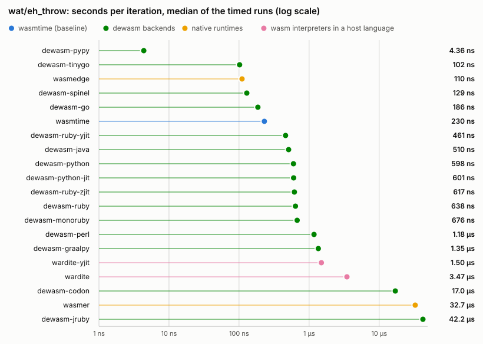
</picture>

Full numbers for <code>wat/eh_throw</code>

| Runner | Iterations | Minimum `ns/op` | Median `ns/op` | Cold start `t(0)` | Total `t(N)` | vs. `wasmtime` | Load |
| --- | --- | --- | --- | --- | --- | --- | --- |
| `wasmtime` | 1 298 910 | 227.4 | 229.5 | 5.3 ms | 300.7 ms | 1.00x | — |
| `wasmer` | 9 367 | 32661 | 32686 | 9.2 ms | 315.1 ms | 144x | — |
| `wasmedge` | 2 919 264 | 109.0 | 110.3 | 20.2 ms | 338.5 ms | 0.48x | — |
| `dewasm-ruby` | 439 091 | 641.1 | 637.9 | 36.3 ms | 317.8 ms | 2.82x | — |
| `dewasm-ruby-yjit` | 437 992 | 462.0 | 461.4 | 38.8 ms | 241.2 ms | 2.03x | — |
| `dewasm-ruby-zjit` | 379 293 | 617.1 | 617.0 | 36.1 ms | 270.2 ms | 2.71x | — |
| `dewasm-monoruby` | 405 802 | 671.3 | 675.8 | 37.2 ms | 309.6 ms | 2.95x | — |
| `dewasm-jruby` | 5 812 | 33643 | 42150 | 1.32 s | 1.52 s | 148x | — |
| `dewasm-spinel` | 2 473 082 | 127.9 | 129.0 | 2.4 ms | 318.7 ms | 0.56x | — |
| `dewasm-python` | 465 386 | 598.7 | 597.7 | 22.7 ms | 301.3 ms | 2.63x | — |
| `dewasm-python-jit` | 517 674 | 599.8 | 601.4 | 19.7 ms | 330.3 ms | 2.64x | — |
| `dewasm-pypy` | 4 000 000 | 4.24 | 4.36 | 39.4 ms | 56.3 ms | 0.02x | — |
| `dewasm-graalpy` | 155 729 | 1357 | 1354 | 47.1 ms | 258.3 ms | 5.97x | — |
| `dewasm-perl` | 251 704 | 1174 | 1176 | 41.7 ms | 337.3 ms | 5.16x | — |
| `dewasm-go` | 1 644 429 | 184.2 | 185.8 | 2.8 ms | 305.7 ms | 0.81x | — |
| `dewasm-tinygo` | 2 901 856 | 101.7 | 101.9 | 1.8 ms | 297.0 ms | 0.45x | — |
| `dewasm-java` | 440 664 | 511.0 | 510.3 | 55.2 ms | 280.4 ms | 2.25x | — |
| `dewasm-codon` | 15 334 | 16964 | 17014 | 12.7 ms | 272.9 ms | 75x | — |
| `wardite` | 84 096 | 3443 | 3471 | 57.4 ms | 347.0 ms | 15x | 3.7 ms |
| `wardite-yjit` | 141 640 | 1497 | 1495 | 152.6 ms | 364.6 ms | 6.58x | 46.5 ms |

#### `wat/eh_try`

<picture>
  <source media="(prefers-color-scheme: dark)" srcset="figs/wat-eh-try-dark.svg">
  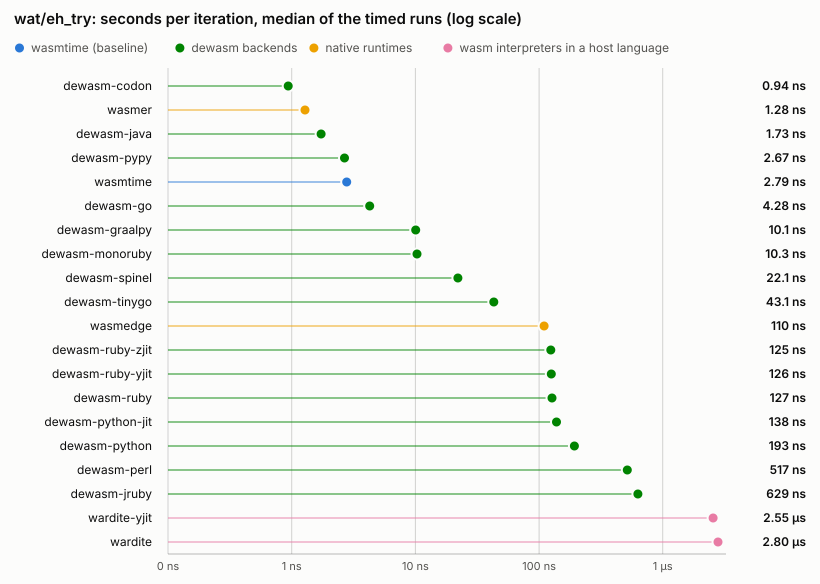
</picture>

Full numbers for <code>wat/eh_try</code>

| Runner | Iterations | Minimum `ns/op` | Median `ns/op` | Cold start `t(0)` | Total `t(N)` | vs. `wasmtime` | Load |
| --- | --- | --- | --- | --- | --- | --- | --- |
| `wasmtime` | 88 791 502 | 2.78 | 2.79 | 5.1 ms | 252.1 ms | 1.00x | — |
| `wasmer` | 225 986 039 | 1.27 | 1.28 | 8.9 ms | 295.1 ms | 0.46x | — |
| `wasmedge` | 2 981 471 | 109.7 | 109.7 | 20.4 ms | 347.5 ms | 39x | — |
| `dewasm-ruby` | 2 005 436 | 126.7 | 127.2 | 36.9 ms | 290.9 ms | 46x | — |
| `dewasm-ruby-yjit` | 1 525 660 | 125.5 | 125.7 | 35.4 ms | 226.9 ms | 45x | — |
| `dewasm-ruby-zjit` | 1 987 425 | 125.5 | 124.5 | 36.0 ms | 285.3 ms | 45x | — |
| `dewasm-monoruby` | 28 274 822 | 10.3 | 10.3 | 34.9 ms | 326.9 ms | 3.71x | — |
| `dewasm-jruby` | 320 599 | 590.2 | 629.5 | 1.33 s | 1.52 s | 212x | — |
| `dewasm-spinel` | 12 904 309 | 21.4 | 22.1 | 2.2 ms | 277.9 ms | 7.68x | — |
| `dewasm-python` | 1 317 067 | 191.7 | 193.0 | 18.3 ms | 270.8 ms | 69x | — |
| `dewasm-python-jit` | 1 910 546 | 137.7 | 138.4 | 19.9 ms | 283.0 ms | 49x | — |
| `dewasm-pypy` | 93 568 694 | 2.68 | 2.67 | 38.3 ms | 288.7 ms | 0.96x | — |
| `dewasm-graalpy` | 18 356 048 | 10.0 | 10.1 | 48.0 ms | 232.0 ms | 3.60x | — |
| `dewasm-perl` | 562 499 | 516.8 | 517.1 | 42.2 ms | 332.9 ms | 186x | — |
| `dewasm-go` | 70 566 793 | 4.27 | 4.28 | 2.4 ms | 303.9 ms | 1.54x | — |
| `dewasm-tinygo` | 5 804 639 | 42.8 | 43.1 | 1.9 ms | 250.5 ms | 15x | — |
| `dewasm-java` | 122 292 268 | 1.65 | 1.73 | 54.8 ms | 256.9 ms | 0.59x | — |
| `dewasm-codon` | 302 057 844 | 0.94 | 0.94 | 14.0 ms | 297.2 ms | 0.34x | — |
| `wardite` | 65 536 | 2804 | 2797 | 59.7 ms | 243.5 ms | 1008x | 3.7 ms |
| `wardite-yjit` | 106 883 | 2543 | 2552 | 147.6 ms | 419.4 ms | 914x | 48.9 ms |

#### `wat/f32_alu`

<picture>
  <source media="(prefers-color-scheme: dark)" srcset="figs/wat-f32-alu-dark.svg">
  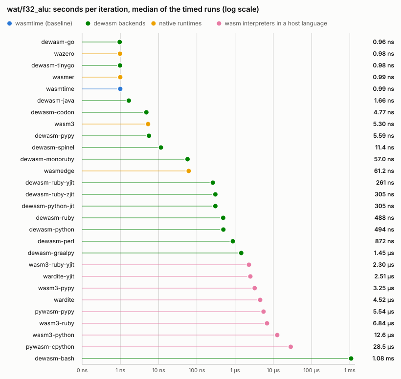
</picture>

Full numbers for <code>wat/f32_alu</code>

| Runner | Iterations | Minimum `ns/op` | Median `ns/op` | Cold start `t(0)` | Total `t(N)` | vs. `wasmtime` | Load |
| --- | --- | --- | --- | --- | --- | --- | --- |
| `wasmtime` | 293 880 250 | 0.99 | 0.99 | 5.2 ms | 295.7 ms | 1.00x | — |
| `wasmer` | 306 932 258 | 0.99 | 0.99 | 9.2 ms | 313.7 ms | 1.00x | — |
| `wasmedge` | 4 357 751 | 61.2 | 61.2 | 19.8 ms | 286.4 ms | 62x | — |
| `wazero` | 315 049 489 | 0.96 | 0.98 | 5.3 ms | 307.1 ms | 0.97x | — |
| `wasm3` | 62 037 797 | 4.79 | 5.30 | 9.9 ms | 307.3 ms | 4.85x | — |
| `dewasm-ruby` | 530 129 | 488.9 | 488.4 | 41.3 ms | 300.5 ms | 495x | — |
| `dewasm-ruby-yjit` | 1 090 725 | 255.2 | 261.4 | 42.8 ms | 321.1 ms | 258x | — |
| `dewasm-ruby-zjit` | 979 062 | 303.5 | 304.5 | 42.0 ms | 339.2 ms | 307x | — |
| `dewasm-monoruby` | 5 766 617 | 52.0 | 57.0 | 38.4 ms | 338.2 ms | 53x | — |
| `dewasm-jruby` | 16 777 216 | 28.9 | — | 1.82 s | 2.31 s | 29x | — |
| `dewasm-spinel` | 16 777 216 | 11.4 | 11.4 | 2.1 ms | 194.1 ms | 12x | — |
| `dewasm-python` | 573 330 | 493.2 | 494.5 | 18.0 ms | 300.8 ms | 499x | — |
| `dewasm-python-jit` | 843 196 | 305.8 | 304.6 | 18.6 ms | 276.4 ms | 309x | — |
| `dewasm-pypy` | 49 402 150 | 5.60 | 5.59 | 40.6 ms | 317.1 ms | 5.66x | — |
| `dewasm-graalpy` | 167 533 | 1382 | 1447 | 48.6 ms | 280.2 ms | 1398x | — |
| `dewasm-perl` | 349 197 | 868.8 | 871.8 | 42.9 ms | 346.3 ms | 879x | — |
| `dewasm-go` | 306 440 930 | 0.96 | 0.96 | 2.5 ms | 295.5 ms | 0.97x | — |
| `dewasm-tinygo` | 311 832 880 | 0.97 | 0.98 | 1.9 ms | 305.4 ms | 0.98x | — |
| `dewasm-java` | 174 259 885 | 1.66 | 1.66 | 51.2 ms | 340.6 ms | 1.68x | — |
| `dewasm-codon` | 62 395 991 | 4.78 | 4.77 | 13.2 ms | 311.3 ms | 4.83x | — |
| `dewasm-bash` | 219 | 1082175 | 1082439 | 11.4 ms | 248.4 ms | 1094861x | — |
| `wasm3-ruby` | 43 865 | 6824 | 6842 | 114.8 ms | 414.1 ms | 6904x | — |
| `wasm3-ruby-yjit` | 83 378 | 2266 | 2297 | 234.0 ms | 422.9 ms | 2292x | — |
| `wasm3-python` | 24 164 | 12677 | 12645 | 303.8 ms | 610.1 ms | 12826x | — |
| `wasm3-pypy` | 55 248 | 3231 | 3253 | 461.5 ms | 640.0 ms | 3269x | — |
| `pywasm-cpython` | 6 676 | 28365 | 28533 | 27.4 ms | 216.7 ms | 28698x | 0.5 ms |
| `pywasm-pypy` | 36 661 | 5441 | 5537 | 74.5 ms | 274.0 ms | 5505x | 2.7 ms |
| `wardite` | 61 609 | 4556 | 4520 | 58.0 ms | 338.6 ms | 4609x | 3.4 ms |
| `wardite-yjit` | 111 169 | 2358 | 2511 | 141.9 ms | 404.1 ms | 2386x | 42.8 ms |

#### `wat/f64_alu`

<picture>
  <source media="(prefers-color-scheme: dark)" srcset="figs/wat-f64-alu-dark.svg">
  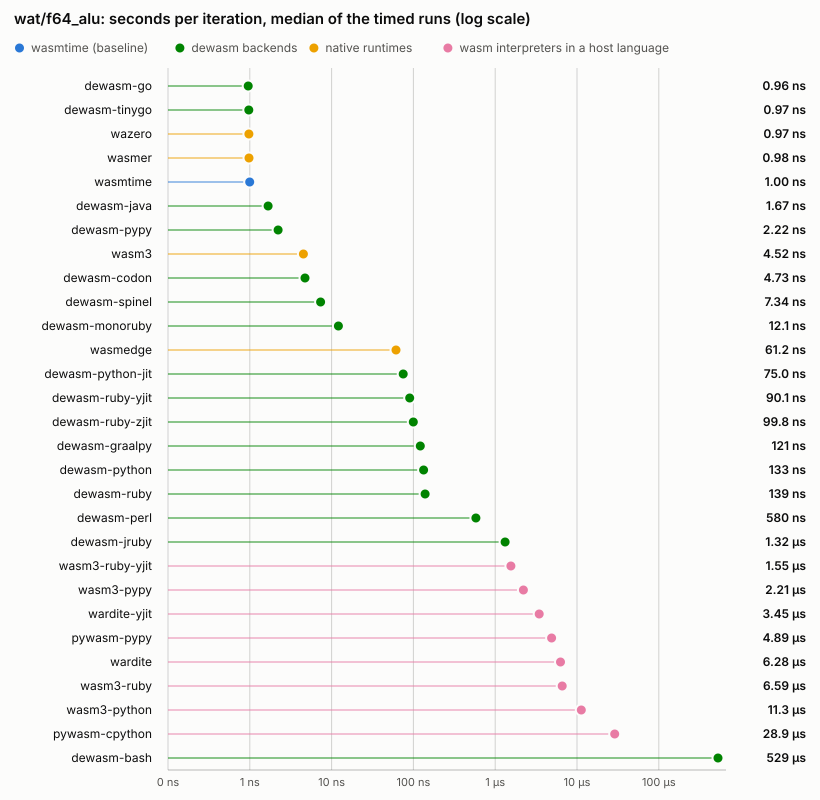
</picture>

Full numbers for <code>wat/f64_alu</code>

| Runner | Iterations | Minimum `ns/op` | Median `ns/op` | Cold start `t(0)` | Total `t(N)` | vs. `wasmtime` | Load |
| --- | --- | --- | --- | --- | --- | --- | --- |
| `wasmtime` | 302 342 861 | 0.99 | 1.00 | 5.1 ms | 304.9 ms | 1.00x | — |
| `wasmer` | 317 338 784 | 0.97 | 0.98 | 9.8 ms | 318.5 ms | 0.98x | — |
| `wasmedge` | 3 713 648 | 61.2 | 61.2 | 19.8 ms | 247.0 ms | 62x | — |
| `wazero` | 318 101 741 | 0.97 | 0.97 | 5.3 ms | 313.9 ms | 0.98x | — |
| `wasm3` | 67 396 797 | 4.49 | 4.52 | 7.3 ms | 310.2 ms | 4.53x | — |
| `dewasm-ruby` | 2 675 287 | 121.6 | 138.9 | 40.4 ms | 365.6 ms | 123x | — |
| `dewasm-ruby-yjit` | 2 028 515 | 82.6 | 90.1 | 48.0 ms | 215.5 ms | 83x | — |
| `dewasm-ruby-zjit` | 3 935 404 | 96.7 | 99.8 | 49.3 ms | 429.8 ms | 98x | — |
| `dewasm-monoruby` | 22 176 419 | 11.9 | 12.1 | 39.3 ms | 303.1 ms | 12x | — |
| `dewasm-jruby` | 392 727 | 1206 | 1321 | 1.33 s | 1.81 s | 1217x | — |
| `dewasm-spinel` | 40 893 275 | 7.34 | 7.34 | 2.2 ms | 302.2 ms | 7.40x | — |
| `dewasm-python` | 2 071 029 | 133.0 | 133.2 | 18.8 ms | 294.2 ms | 134x | — |
| `dewasm-python-jit` | 2 691 662 | 75.2 | 75.0 | 18.8 ms | 221.3 ms | 76x | — |
| `dewasm-pypy` | 90 477 130 | 2.22 | 2.22 | 38.3 ms | 239.6 ms | 2.24x | — |
| `dewasm-graalpy` | 1 452 504 | 116.0 | 121.3 | 48.9 ms | 217.4 ms | 117x | — |
| `dewasm-perl` | 494 565 | 577.9 | 580.3 | 48.0 ms | 333.7 ms | 583x | — |
| `dewasm-go` | 307 575 458 | 0.96 | 0.96 | 2.4 ms | 296.3 ms | 0.96x | — |
| `dewasm-tinygo` | 305 041 067 | 0.97 | 0.97 | 1.8 ms | 298.3 ms | 0.98x | — |
| `dewasm-java` | 175 120 396 | 1.66 | 1.67 | 50.6 ms | 340.5 ms | 1.67x | — |
| `dewasm-codon` | 63 326 114 | 4.73 | 4.73 | 13.0 ms | 312.7 ms | 4.77x | — |
| `dewasm-bash` | 575 | 525463 | 528894 | 11.8 ms | 313.9 ms | 529992x | — |
| `wasm3-ruby` | 32 940 | 6708 | 6588 | 119.0 ms | 340.0 ms | 6766x | — |
| `wasm3-ruby-yjit` | 92 883 | 1681 | 1554 | 294.5 ms | 450.7 ms | 1696x | — |
| `wasm3-python` | 140 544 | 11529 | 11284 | 340.3 ms | 1.96 s | 11628x | — |
| `wasm3-pypy` | 93 000 | 2169 | 2211 | 472.9 ms | 674.6 ms | 2188x | — |
| `pywasm-cpython` | 6 465 | 28393 | 28873 | 27.2 ms | 210.7 ms | 28638x | 0.6 ms |
| `pywasm-pypy` | 40 189 | 4860 | 4888 | 74.6 ms | 269.9 ms | 4902x | 2.6 ms |
| `wardite` | 45 083 | 6289 | 6279 | 57.7 ms | 341.2 ms | 6343x | 4.1 ms |
| `wardite-yjit` | 58 102 | 3422 | 3446 | 144.8 ms | 343.6 ms | 3451x | 44.0 ms |

#### `wat/i32_alu`

<picture>
  <source media="(prefers-color-scheme: dark)" srcset="figs/wat-i32-alu-dark.svg">
  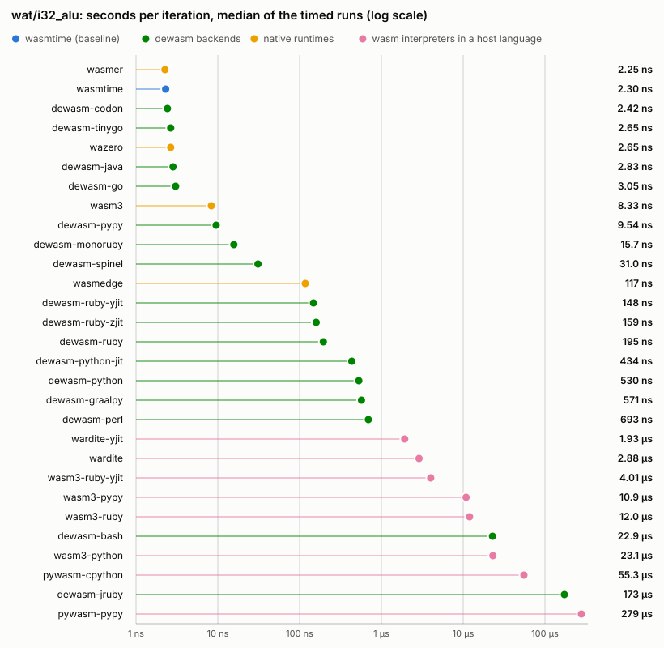
</picture>

Full numbers for <code>wat/i32_alu</code>

| Runner | Iterations | Minimum `ns/op` | Median `ns/op` | Cold start `t(0)` | Total `t(N)` | vs. `wasmtime` | Load |
| --- | --- | --- | --- | --- | --- | --- | --- |
| `wasmtime` | 129 296 420 | 2.30 | 2.30 | 5.3 ms | 303.1 ms | 1.00x | — |
| `wasmer` | 119 304 765 | 2.27 | 2.25 | 13.0 ms | 283.4 ms | 0.98x | — |
| `wasmedge` | 16 777 216 | 116.2 | 117.3 | 31.2 ms | 1.98 s | 50x | — |
| `wazero` | 112 405 241 | 2.64 | 2.65 | 5.1 ms | 301.4 ms | 1.14x | — |
| `wasm3` | 35 821 930 | 8.34 | 8.33 | 7.0 ms | 305.7 ms | 3.62x | — |
| `dewasm-ruby` | 1 462 461 | 195.0 | 195.3 | 35.4 ms | 320.5 ms | 85x | — |
| `dewasm-ruby-yjit` | 1 139 933 | 149.0 | 147.9 | 35.2 ms | 205.1 ms | 65x | — |
| `dewasm-ruby-zjit` | 1 603 929 | 157.8 | 159.4 | 36.4 ms | 289.4 ms | 68x | — |
| `dewasm-monoruby` | 19 102 772 | 15.6 | 15.7 | 35.0 ms | 333.9 ms | 6.79x | — |
| `dewasm-jruby` | 479 | 76165 | 173143 | 1.32 s | 1.36 s | 33066x | — |
| `dewasm-spinel` | 10 129 211 | 30.9 | 31.0 | 2.2 ms | 315.6 ms | 13x | — |
| `dewasm-python` | 557 491 | 527.3 | 530.2 | 18.6 ms | 312.5 ms | 229x | — |
| `dewasm-python-jit` | 653 767 | 434.1 | 434.3 | 18.6 ms | 302.4 ms | 188x | — |
| `dewasm-pypy` | 29 670 620 | 9.52 | 9.54 | 40.2 ms | 322.8 ms | 4.14x | — |
| `dewasm-graalpy` | 337 531 | 565.1 | 571.1 | 48.4 ms | 239.1 ms | 245x | — |
| `dewasm-perl` | 437 644 | 692.1 | 693.1 | 42.3 ms | 345.2 ms | 300x | — |
| `dewasm-go` | 97 658 189 | 3.04 | 3.05 | 2.5 ms | 299.2 ms | 1.32x | — |
| `dewasm-tinygo` | 125 619 884 | 2.65 | 2.65 | 2.0 ms | 334.7 ms | 1.15x | — |
| `dewasm-java` | 500 000 000 | 2.74 | 2.83 | 204.9 ms | 1.57 s | 1.19x | — |
| `dewasm-codon` | 127 715 989 | 2.42 | 2.42 | 13.9 ms | 322.6 ms | 1.05x | — |
| `dewasm-bash` | 10 650 | 23733 | 22851 | 18.9 ms | 271.6 ms | 10303x | — |
| `wasm3-ruby` | 23 522 | 11988 | 11976 | 119.8 ms | 401.8 ms | 5204x | — |
| `wasm3-ruby-yjit` | 58 422 | 3950 | 4011 | 264.3 ms | 495.1 ms | 1715x | — |
| `wasm3-python` | 19 785 | 22966 | 23098 | 319.9 ms | 774.3 ms | 9970x | — |
| `wasm3-pypy` | 16 104 | 10157 | 10872 | 476.4 ms | 640.0 ms | 4410x | — |
| `pywasm-cpython` | 4 080 | 55115 | 55269 | 29.3 ms | 254.1 ms | 23928x | 0.6 ms |
| `pywasm-pypy` | 512 | 277763 | 279177 | 85.5 ms | 227.7 ms | 120588x | 3.2 ms |
| `wardite` | 103 117 | 2858 | 2885 | 63.8 ms | 358.5 ms | 1241x | 3.9 ms |
| `wardite-yjit` | 148 175 | 1926 | 1929 | 153.6 ms | 439.0 ms | 836x | 41.1 ms |

#### `wat/i32_div`

<picture>
  <source media="(prefers-color-scheme: dark)" srcset="figs/wat-i32-div-dark.svg">
  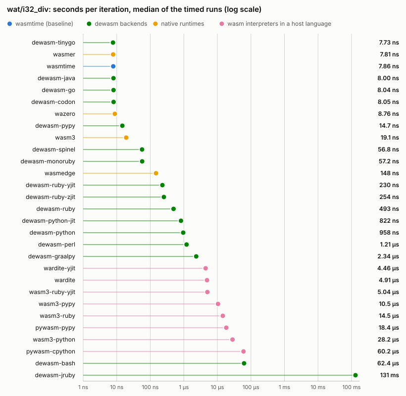
</picture>

Full numbers for <code>wat/i32_div</code>

| Runner | Iterations | Minimum `ns/op` | Median `ns/op` | Cold start `t(0)` | Total `t(N)` | vs. `wasmtime` | Load |
| --- | --- | --- | --- | --- | --- | --- | --- |
| `wasmtime` | 38 840 581 | 7.84 | 7.86 | 5.7 ms | 310.1 ms | 1.00x | — |
| `wasmer` | 38 601 700 | 7.81 | 7.81 | 9.9 ms | 311.5 ms | 1.00x | — |
| `wasmedge` | 2 065 845 | 142.1 | 148.1 | 20.7 ms | 314.3 ms | 18x | — |
| `wazero` | 38 603 514 | 7.94 | 8.76 | 5.9 ms | 312.5 ms | 1.01x | — |
| `wasm3` | 16 692 916 | 19.1 | 19.1 | 7.8 ms | 325.9 ms | 2.43x | — |
| `dewasm-ruby` | 623 162 | 475.8 | 493.4 | 38.9 ms | 335.3 ms | 61x | — |
| `dewasm-ruby-yjit` | 854 555 | 223.3 | 230.2 | 38.9 ms | 229.8 ms | 28x | — |
| `dewasm-ruby-zjit` | 1 156 868 | 258.2 | 254.2 | 39.5 ms | 338.1 ms | 33x | — |
| `dewasm-monoruby` | 4 485 865 | 56.6 | 57.2 | 34.9 ms | 288.7 ms | 7.22x | — |
| `dewasm-jruby` | 1 | 549336833 | 131168125 | 1.37 s | 1.92 s | 70106746x | — |
| `dewasm-spinel` | 3 970 737 | 56.9 | 56.8 | 2.6 ms | 228.4 ms | 7.26x | — |
| `dewasm-python` | 299 296 | 951.1 | 958.4 | 18.5 ms | 303.1 ms | 121x | — |
| `dewasm-python-jit` | 335 234 | 821.6 | 822.5 | 19.7 ms | 295.2 ms | 105x | — |
| `dewasm-pypy` | 16 402 246 | 14.7 | 14.7 | 42.0 ms | 282.9 ms | 1.87x | — |
| `dewasm-graalpy` | 94 433 | 2305 | 2340 | 50.3 ms | 268.0 ms | 294x | — |
| `dewasm-perl` | 236 126 | 1215 | 1209 | 42.2 ms | 329.1 ms | 155x | — |
| `dewasm-go` | 38 490 066 | 7.84 | 8.04 | 3.0 ms | 304.9 ms | 1.00x | — |
| `dewasm-tinygo` | 38 871 064 | 7.73 | 7.73 | 1.8 ms | 302.3 ms | 0.99x | — |
| `dewasm-java` | 25 317 366 | 7.99 | 8.00 | 49.2 ms | 251.4 ms | 1.02x | — |
| `dewasm-codon` | 37 342 103 | 8.04 | 8.05 | 12.6 ms | 312.7 ms | 1.03x | — |
| `dewasm-bash` | 4 789 | 61434 | 62443 | 11.1 ms | 305.3 ms | 7840x | — |
| `wasm3-ruby` | 17 151 | 14433 | 14517 | 112.4 ms | 360.0 ms | 1842x | — |
| `wasm3-ruby-yjit` | 62 774 | 5074 | 5039 | 235.5 ms | 554.0 ms | 648x | — |
| `wasm3-python` | 7 910 | 28109 | 28239 | 300.6 ms | 522.9 ms | 3587x | — |
| `wasm3-pypy` | 19 608 | 9993 | 10456 | 459.0 ms | 655.0 ms | 1275x | — |
| `pywasm-cpython` | 4 800 | 60157 | 60224 | 27.4 ms | 316.2 ms | 7677x | 0.6 ms |
| `pywasm-pypy` | 11 048 | 18432 | 18439 | 72.7 ms | 276.3 ms | 2352x | 2.9 ms |
| `wardite` | 74 168 | 4847 | 4914 | 56.7 ms | 416.2 ms | 619x | 4.2 ms |
| `wardite-yjit` | 68 506 | 4394 | 4464 | 150.8 ms | 451.8 ms | 561x | 57.3 ms |

#### `wat/i64_alu`

<picture>
  <source media="(prefers-color-scheme: dark)" srcset="figs/wat-i64-alu-dark.svg">
  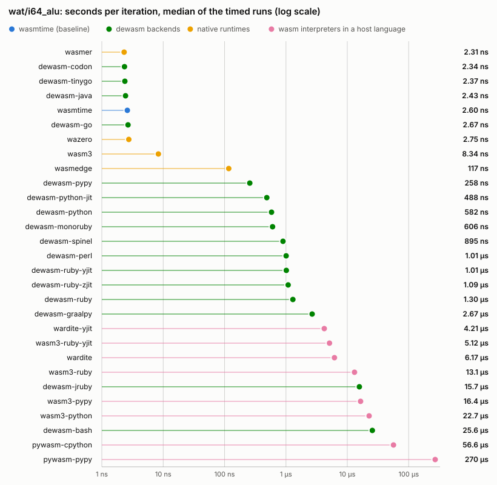
</picture>

Full numbers for <code>wat/i64_alu</code>

| Runner | Iterations | Minimum `ns/op` | Median `ns/op` | Cold start `t(0)` | Total `t(N)` | vs. `wasmtime` | Load |
| --- | --- | --- | --- | --- | --- | --- | --- |
| `wasmtime` | 107 767 417 | 2.59 | 2.60 | 12.8 ms | 291.7 ms | 1.00x | — |
| `wasmer` | 97 311 847 | 2.34 | 2.31 | 16.5 ms | 244.7 ms | 0.91x | — |
| `wasmedge` | 2 425 924 | 116.8 | 117.0 | 22.0 ms | 305.4 ms | 45x | — |
| `wazero` | 109 132 821 | 2.75 | 2.75 | 6.0 ms | 306.1 ms | 1.06x | — |
| `wasm3` | 35 986 778 | 8.29 | 8.34 | 6.8 ms | 305.1 ms | 3.20x | — |
| `dewasm-ruby` | 223 756 | 1296 | 1297 | 39.8 ms | 329.8 ms | 501x | — |
| `dewasm-ruby-yjit` | 248 002 | 1011 | 1014 | 39.2 ms | 289.8 ms | 390x | — |
| `dewasm-ruby-zjit` | 249 385 | 1084 | 1086 | 39.3 ms | 309.7 ms | 419x | — |
| `dewasm-monoruby` | 400 338 | 608.5 | 606.3 | 37.6 ms | 281.3 ms | 235x | — |
| `dewasm-jruby` | 906 | — | 15732 | 1.41 s | 1.39 s | — | — |
| `dewasm-spinel` | 337 226 | 894.3 | 894.9 | 2.4 ms | 304.0 ms | 345x | — |
| `dewasm-python` | 512 990 | 582.0 | 582.4 | 19.7 ms | 318.3 ms | 225x | — |
| `dewasm-python-jit` | 562 479 | 488.8 | 488.3 | 19.7 ms | 294.7 ms | 189x | — |
| `dewasm-pypy` | 858 592 | 257.8 | 257.6 | 41.6 ms | 263.0 ms | 100x | — |
| `dewasm-graalpy` | 93 912 | 2667 | 2675 | 50.2 ms | 300.7 ms | 1030x | — |
| `dewasm-perl` | 268 951 | 1009 | 1007 | 43.0 ms | 314.4 ms | 390x | — |
| `dewasm-go` | 110 024 049 | 2.67 | 2.67 | 2.8 ms | 296.4 ms | 1.03x | — |
| `dewasm-tinygo` | 126 832 683 | 2.36 | 2.37 | 1.9 ms | 301.6 ms | 0.91x | — |
| `dewasm-java` | 76 431 929 | 2.41 | 2.43 | 53.0 ms | 237.3 ms | 0.93x | — |
| `dewasm-codon` | 127 611 828 | 2.34 | 2.34 | 14.2 ms | 312.6 ms | 0.90x | — |
| `dewasm-bash` | 11 341 | 25544 | 25550 | 13.7 ms | 303.4 ms | 9868x | — |
| `wasm3-ruby` | 13 986 | 13166 | 13096 | 116.8 ms | 300.9 ms | 5087x | — |
| `wasm3-ruby-yjit` | 43 761 | 5168 | 5120 | 254.7 ms | 480.8 ms | 1997x | — |
| `wasm3-python` | 13 259 | 22391 | 22664 | 307.9 ms | 604.7 ms | 8650x | — |
| `wasm3-pypy` | 11 212 | 15915 | 16442 | 468.9 ms | 647.4 ms | 6149x | — |
| `pywasm-cpython` | 5 189 | 56406 | 56575 | 29.6 ms | 322.3 ms | 21791x | 0.6 ms |
| `pywasm-pypy` | 664 | 268824 | 270446 | 81.1 ms | 259.6 ms | 103856x | 3.1 ms |
| `wardite` | 36 878 | 5643 | 6172 | 60.3 ms | 268.4 ms | 2180x | 4.2 ms |
| `wardite-yjit` | 63 383 | 4201 | 4214 | 156.4 ms | 422.7 ms | 1623x | 41.2 ms |

#### `wat/i64_div`

<picture>
  <source media="(prefers-color-scheme: dark)" srcset="figs/wat-i64-div-dark.svg">
  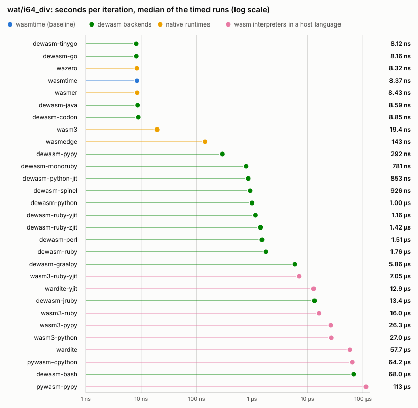
</picture>

Full numbers for <code>wat/i64_div</code>

| Runner | Iterations | Minimum `ns/op` | Median `ns/op` | Cold start `t(0)` | Total `t(N)` | vs. `wasmtime` | Load |
| --- | --- | --- | --- | --- | --- | --- | --- |
| `wasmtime` | 35 764 446 | 8.37 | 8.37 | 5.8 ms | 305.1 ms | 1.00x | — |
| `wasmer` | 35 803 031 | 8.42 | 8.43 | 9.8 ms | 311.3 ms | 1.01x | — |
| `wasmedge` | 2 024 999 | 139.7 | 143.2 | 21.6 ms | 304.4 ms | 17x | — |
| `wazero` | 35 630 344 | 8.30 | 8.32 | 5.5 ms | 301.1 ms | 0.99x | — |
| `wasm3` | 14 567 148 | 19.4 | 19.4 | 6.6 ms | 289.2 ms | 2.32x | — |
| `dewasm-ruby` | 160 542 | 1741 | 1758 | 35.5 ms | 315.0 ms | 208x | — |
| `dewasm-ruby-yjit` | 213 627 | 1156 | 1156 | 35.4 ms | 282.5 ms | 138x | — |
| `dewasm-ruby-zjit` | 175 137 | 1415 | 1416 | 35.4 ms | 283.2 ms | 169x | — |
| `dewasm-monoruby` | 359 525 | 779.1 | 781.4 | 34.4 ms | 314.5 ms | 93x | — |
| `dewasm-jruby` | 13 214 | 15982 | 13362 | 1.29 s | 1.50 s | 1910x | — |
| `dewasm-spinel` | 290 285 | 926.4 | 926.4 | 2.1 ms | 271.0 ms | 111x | — |
| `dewasm-python` | 303 196 | 1002 | 1002 | 18.0 ms | 321.8 ms | 120x | — |
| `dewasm-python-jit` | 333 426 | 844.6 | 853.0 | 18.1 ms | 299.7 ms | 101x | — |
| `dewasm-pypy` | 965 049 | 291.2 | 292.2 | 38.7 ms | 319.7 ms | 35x | — |
| `dewasm-graalpy` | 33 529 | 5752 | 5859 | 46.1 ms | 239.0 ms | 687x | — |
| `dewasm-perl` | 199 483 | 1499 | 1508 | 42.0 ms | 341.1 ms | 179x | — |
| `dewasm-go` | 36 816 585 | 8.15 | 8.16 | 2.4 ms | 302.6 ms | 0.97x | — |
| `dewasm-tinygo` | 37 013 803 | 8.12 | 8.12 | 1.7 ms | 302.3 ms | 0.97x | — |
| `dewasm-java` | 21 801 704 | 8.60 | 8.59 | 48.9 ms | 236.3 ms | 1.03x | — |
| `dewasm-codon` | 35 329 700 | 8.50 | 8.85 | 12.9 ms | 313.3 ms | 1.02x | — |
| `dewasm-bash` | 4 325 | 67733 | 68003 | 11.2 ms | 304.2 ms | 8094x | — |
| `wasm3-ruby` | 14 585 | 16084 | 16028 | 111.7 ms | 346.3 ms | 1922x | — |
| `wasm3-ruby-yjit` | 34 048 | 7039 | 7050 | 234.5 ms | 474.1 ms | 841x | — |
| `wasm3-python` | 9 286 | 27056 | 26984 | 304.1 ms | 555.4 ms | 3233x | — |
| `wasm3-pypy` | 7 596 | 25556 | 26319 | 458.9 ms | 653.0 ms | 3054x | — |
| `pywasm-cpython` | 4 618 | 64065 | 64211 | 27.3 ms | 323.1 ms | 7656x | 0.6 ms |
| `pywasm-pypy` | 1 724 | 114785 | 113142 | 73.1 ms | 270.9 ms | 13717x | 2.8 ms |
| `wardite` | 4 393 | 57832 | 57720 | 57.5 ms | 311.5 ms | 6911x | 3.6 ms |
| `wardite-yjit` | 17 357 | 12859 | 12876 | 139.5 ms | 362.7 ms | 1537x | 39.6 ms |

#### `wat/mem_narrow`

<picture>
  <source media="(prefers-color-scheme: dark)" srcset="figs/wat-mem-narrow-dark.svg">
  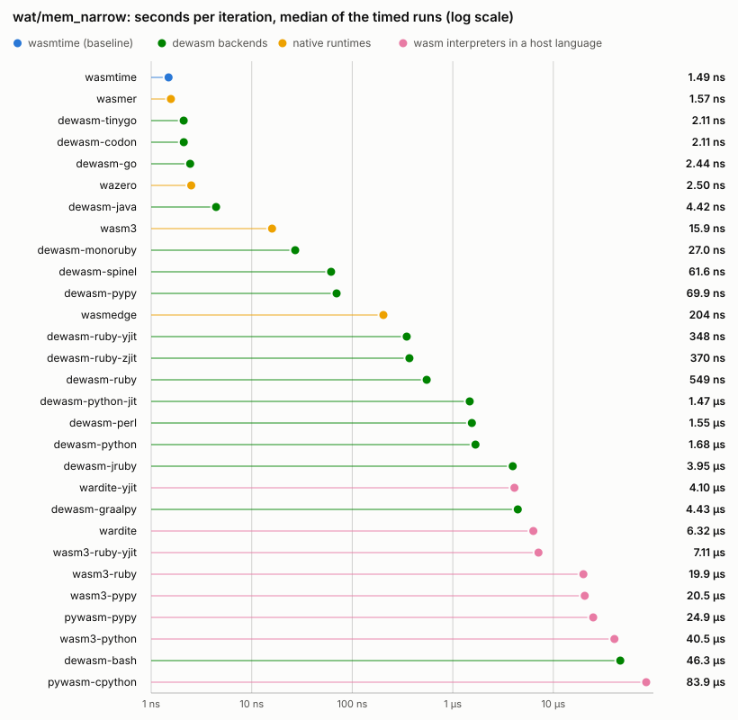
</picture>

Full numbers for <code>wat/mem_narrow</code>

| Runner | Iterations | Minimum `ns/op` | Median `ns/op` | Cold start `t(0)` | Total `t(N)` | vs. `wasmtime` | Load |
| --- | --- | --- | --- | --- | --- | --- | --- |
| `wasmtime` | 198 886 909 | 1.49 | 1.49 | 5.2 ms | 301.0 ms | 1.00x | — |
| `wasmer` | 195 139 370 | 1.56 | 1.57 | 9.4 ms | 314.7 ms | 1.05x | — |
| `wasmedge` | 1 370 623 | 204.8 | 204.1 | 19.9 ms | 300.5 ms | 138x | — |
| `wazero` | 121 351 498 | 2.50 | 2.50 | 5.3 ms | 309.1 ms | 1.68x | — |
| `wasm3` | 12 996 736 | 15.9 | 15.9 | 6.6 ms | 213.5 ms | 11x | — |
| `dewasm-ruby` | 554 070 | 540.9 | 549.4 | 35.8 ms | 335.5 ms | 364x | — |
| `dewasm-ruby-yjit` | 679 475 | 346.1 | 348.1 | 35.8 ms | 271.0 ms | 233x | — |
| `dewasm-ruby-zjit` | 514 543 | 368.9 | 370.3 | 35.2 ms | 225.0 ms | 248x | — |
| `dewasm-monoruby` | 10 974 656 | 27.1 | 27.0 | 34.6 ms | 331.6 ms | 18x | — |
| `dewasm-jruby` | 47 308 | 4100 | 3947 | 1.31 s | 1.50 s | 2757x | — |
| `dewasm-spinel` | 4 913 765 | 61.5 | 61.6 | 2.1 ms | 304.4 ms | 41x | — |
| `dewasm-python` | 183 665 | 1677 | 1680 | 18.0 ms | 326.1 ms | 1128x | — |
| `dewasm-python-jit` | 210 122 | 1404 | 1474 | 17.9 ms | 313.0 ms | 944x | — |
| `dewasm-pypy` | 4 023 446 | 70.0 | 69.9 | 39.1 ms | 320.5 ms | 47x | — |
| `dewasm-graalpy` | 51 627 | 4373 | 4426 | 46.5 ms | 272.3 ms | 2941x | — |
| `dewasm-perl` | 193 780 | 1541 | 1548 | 42.1 ms | 340.8 ms | 1037x | — |
| `dewasm-go` | 123 173 197 | 2.43 | 2.44 | 2.5 ms | 301.8 ms | 1.63x | — |
| `dewasm-tinygo` | 143 348 038 | 2.10 | 2.11 | 1.9 ms | 303.3 ms | 1.41x | — |
| `dewasm-java` | 48 242 101 | 4.42 | 4.42 | 50.5 ms | 263.7 ms | 2.97x | — |
| `dewasm-codon` | 142 728 802 | 2.10 | 2.11 | 12.5 ms | 312.9 ms | 1.42x | — |
| `dewasm-bash` | 5 650 | 46172 | 46344 | 11.0 ms | 271.9 ms | 31049x | — |
| `wasm3-ruby` | 9 754 | 19610 | 19911 | 113.8 ms | 305.1 ms | 13187x | — |
| `wasm3-ruby-yjit` | 45 572 | 7193 | 7106 | 248.8 ms | 576.6 ms | 4837x | — |
| `wasm3-python` | 5 610 | 40248 | 40502 | 300.5 ms | 526.3 ms | 27066x | — |
| `wasm3-pypy` | 9 266 | 20094 | 20533 | 457.5 ms | 643.7 ms | 13513x | — |
| `pywasm-cpython` | 3 445 | 83685 | 83869 | 27.4 ms | 315.7 ms | 56276x | 0.7 ms |
| `pywasm-pypy` | 7 692 | 24824 | 24931 | 73.7 ms | 264.7 ms | 16693x | 3.1 ms |
| `wardite` | 47 578 | 6326 | 6319 | 56.8 ms | 357.8 ms | 4254x | 3.5 ms |
| `wardite-yjit` | 50 430 | 4046 | 4103 | 138.2 ms | 342.3 ms | 2721x | 37.5 ms |

#### `wat/mem_rw`

<picture>
  <source media="(prefers-color-scheme: dark)" srcset="figs/wat-mem-rw-dark.svg">
  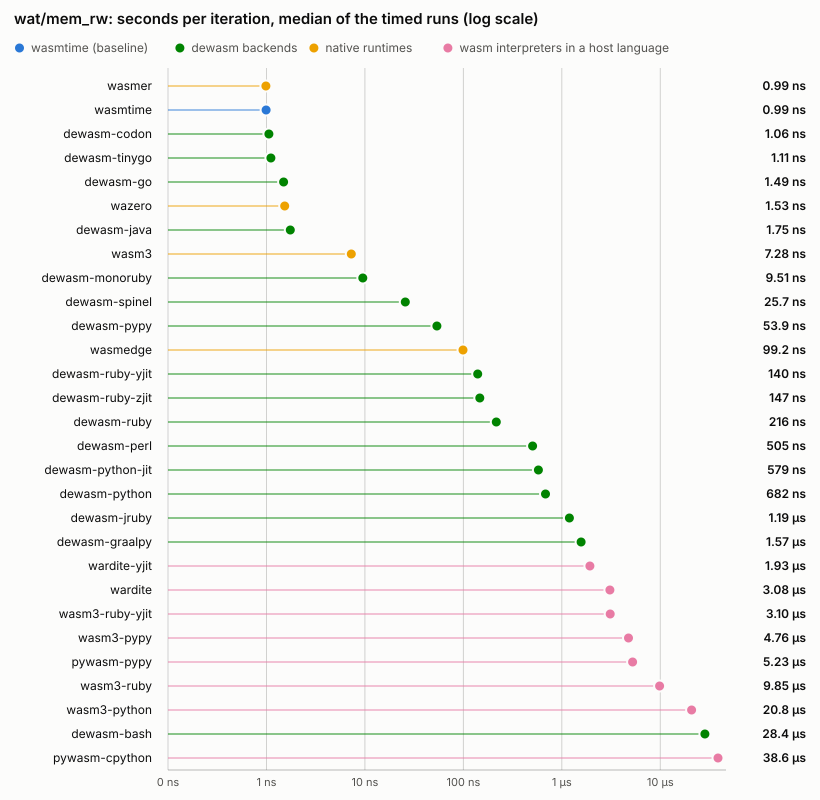
</picture>

Full numbers for <code>wat/mem_rw</code>

| Runner | Iterations | Minimum `ns/op` | Median `ns/op` | Cold start `t(0)` | Total `t(N)` | vs. `wasmtime` | Load |
| --- | --- | --- | --- | --- | --- | --- | --- |
| `wasmtime` | 294 716 289 | 0.99 | 0.99 | 5.2 ms | 297.5 ms | 1.00x | — |
| `wasmer` | 313 714 985 | 0.99 | 0.99 | 9.5 ms | 319.1 ms | 0.99x | — |
| `wasmedge` | 2 910 574 | 98.1 | 99.2 | 19.5 ms | 304.9 ms | 99x | — |
| `wazero` | 196 935 898 | 1.52 | 1.53 | 5.2 ms | 305.3 ms | 1.54x | — |
| `wasm3` | 41 079 137 | 7.29 | 7.28 | 7.3 ms | 306.7 ms | 7.35x | — |
| `dewasm-ruby` | 1 393 846 | 215.0 | 216.1 | 35.3 ms | 335.0 ms | 217x | — |
| `dewasm-ruby-yjit` | 1 748 077 | 140.0 | 139.9 | 35.4 ms | 280.0 ms | 141x | — |
| `dewasm-ruby-zjit` | 1 573 760 | 147.3 | 146.9 | 34.8 ms | 266.6 ms | 148x | — |
| `dewasm-monoruby` | 36 129 682 | 9.44 | 9.51 | 33.8 ms | 374.9 ms | 9.52x | — |
| `dewasm-jruby` | 152 094 | 1302 | 1195 | 1.30 s | 1.50 s | 1313x | — |
| `dewasm-spinel` | 9 321 227 | 25.7 | 25.7 | 2.1 ms | 241.4 ms | 26x | — |
| `dewasm-python` | 338 923 | 679.3 | 682.0 | 17.8 ms | 248.0 ms | 685x | — |
| `dewasm-python-jit` | 505 352 | 579.7 | 578.8 | 17.7 ms | 310.6 ms | 584x | — |
| `dewasm-pypy` | 5 427 973 | 53.7 | 53.9 | 38.2 ms | 329.7 ms | 54x | — |
| `dewasm-graalpy` | 135 677 | 1568 | 1571 | 45.6 ms | 258.4 ms | 1581x | — |
| `dewasm-perl` | 598 551 | 502.3 | 504.6 | 42.0 ms | 342.6 ms | 506x | — |
| `dewasm-go` | 199 794 589 | 1.49 | 1.49 | 2.5 ms | 299.9 ms | 1.50x | — |
| `dewasm-tinygo` | 272 715 267 | 1.10 | 1.11 | 1.8 ms | 302.6 ms | 1.11x | — |
| `dewasm-java` | 147 878 582 | 1.75 | 1.75 | 50.1 ms | 308.3 ms | 1.76x | — |
| `dewasm-codon` | 297 317 548 | 1.06 | 1.06 | 13.2 ms | 328.5 ms | 1.07x | — |
| `dewasm-bash` | 10 032 | 28419 | 28421 | 12.1 ms | 297.2 ms | 28650x | — |
| `wasm3-ruby` | 29 564 | 9690 | 9846 | 110.7 ms | 397.2 ms | 9769x | — |
| `wasm3-ruby-yjit` | 65 858 | 3084 | 3103 | 231.0 ms | 434.1 ms | 3109x | — |
| `wasm3-python` | 14 771 | 19580 | 20809 | 298.9 ms | 588.1 ms | 19739x | — |
| `wasm3-pypy` | 52 342 | 4720 | 4761 | 453.7 ms | 700.8 ms | 4759x | — |
| `pywasm-cpython` | 8 033 | 37978 | 38576 | 26.9 ms | 332.0 ms | 38286x | 0.6 ms |
| `pywasm-pypy` | 52 782 | 5159 | 5235 | 74.8 ms | 347.0 ms | 5201x | 3.0 ms |
| `wardite` | 95 307 | 3095 | 3079 | 56.4 ms | 351.4 ms | 3120x | 3.4 ms |
| `wardite-yjit` | 145 298 | 1919 | 1928 | 136.4 ms | 415.2 ms | 1935x | 37.8 ms |

#### `wat/tail_call`

<picture>
  <source media="(prefers-color-scheme: dark)" srcset="figs/wat-tail-call-dark.svg">
  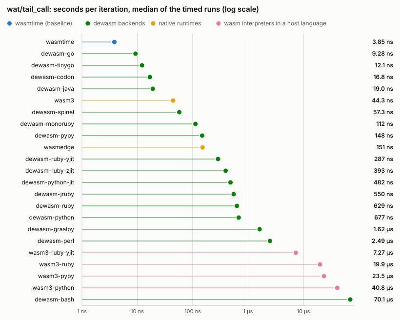
</picture>

Full numbers for <code>wat/tail_call</code>

| Runner | Iterations | Minimum `ns/op` | Median `ns/op` | Cold start `t(0)` | Total `t(N)` | vs. `wasmtime` | Load |
| --- | --- | --- | --- | --- | --- | --- | --- |
| `wasmtime` | 78 109 856 | 3.85 | 3.85 | 5.4 ms | 306.1 ms | 1.00x | — |
| `wasmedge` | 1 737 740 | 151.1 | 150.9 | 19.9 ms | 282.4 ms | 39x | — |
| `wasm3` | 6 603 032 | 44.2 | 44.3 | 6.7 ms | 298.8 ms | 11x | — |
| `dewasm-ruby` | 419 799 | 627.5 | 628.8 | 34.9 ms | 298.3 ms | 163x | — |
| `dewasm-ruby-yjit` | 754 187 | 287.2 | 286.6 | 34.6 ms | 251.3 ms | 75x | — |
| `dewasm-ruby-zjit` | 767 464 | 383.9 | 393.5 | 35.6 ms | 330.3 ms | 100x | — |
| `dewasm-monoruby` | 2 130 169 | 111.5 | 111.9 | 34.2 ms | 271.8 ms | 29x | — |
| `dewasm-jruby` | 402 091 | 554.4 | 549.8 | 1.30 s | 1.53 s | 144x | — |
| `dewasm-spinel` | 5 148 547 | 57.2 | 57.3 | 2.1 ms | 296.4 ms | 15x | — |
| `dewasm-python` | 424 478 | 671.0 | 677.3 | 17.8 ms | 302.6 ms | 174x | — |
| `dewasm-python-jit` | 554 944 | 480.8 | 482.2 | 18.3 ms | 285.2 ms | 125x | — |
| `dewasm-pypy` | 1 924 080 | 148.4 | 148.2 | 38.7 ms | 324.2 ms | 39x | — |
| `dewasm-graalpy` | 99 523 | 1594 | 1618 | 45.8 ms | 204.5 ms | 414x | — |
| `dewasm-perl` | 125 122 | 2487 | 2493 | 41.9 ms | 353.0 ms | 646x | — |
| `dewasm-go` | 33 554 432 | 8.60 | 9.28 | 2.5 ms | 291.0 ms | 2.23x | — |
| `dewasm-tinygo` | 16 777 216 | 12.1 | 12.1 | 1.8 ms | 205.3 ms | 3.15x | — |
| `dewasm-java` | 14 241 873 | 18.8 | 19.0 | 51.4 ms | 318.9 ms | 4.88x | — |
| `dewasm-codon` | 19 506 774 | 16.7 | 16.8 | 12.6 ms | 338.9 ms | 4.35x | — |
| `dewasm-bash` | 4 182 | 69886 | 70120 | 11.3 ms | 303.5 ms | 18151x | — |
| `wasm3-ruby` | 10 393 | 19876 | 19898 | 111.4 ms | 318.0 ms | 5162x | — |
| `wasm3-ruby-yjit` | 37 254 | 7265 | 7270 | 201.6 ms | 472.3 ms | 1887x | — |
| `wasm3-python` | 6 374 | 40974 | 40820 | 297.8 ms | 559.0 ms | 10642x | — |
| `wasm3-pypy` | 7 492 | 23551 | 23496 | 453.2 ms | 629.6 ms | 6117x | — |

#### `c/mandelbrot`

<picture>
  <source media="(prefers-color-scheme: dark)" srcset="figs/c-mandelbrot-dark.svg">
  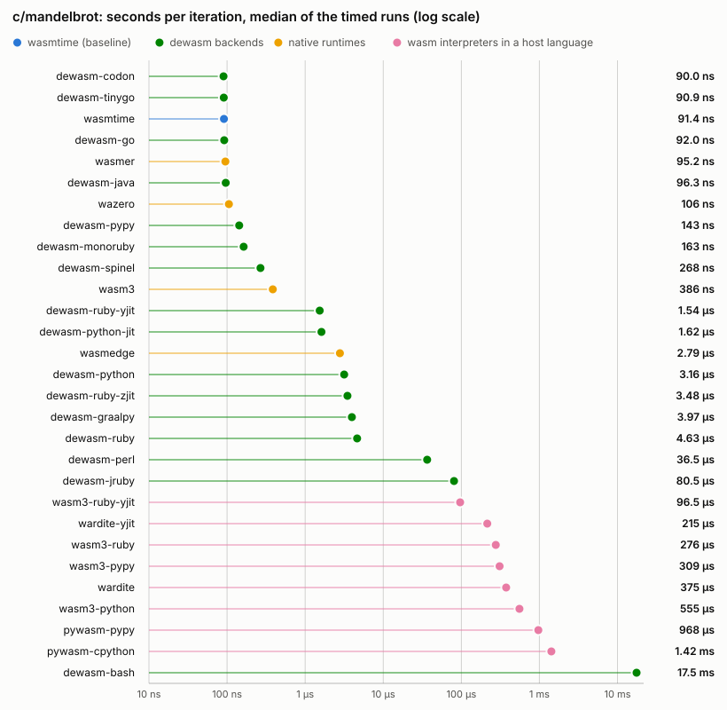
</picture>

Full numbers for <code>c/mandelbrot</code>

| Runner | Iterations | Minimum `ns/op` | Median `ns/op` | Cold start `t(0)` | Total `t(N)` | vs. `wasmtime` | Load |
| --- | --- | --- | --- | --- | --- | --- | --- |
| `wasmtime` | 3 433 651 | 91.2 | 91.4 | 5.6 ms | 318.8 ms | 1.00x | — |
| `wasmer` | 3 046 847 | 95.2 | 95.2 | 9.3 ms | 299.4 ms | 1.04x | — |
| `wasmedge` | 113 664 | 2790 | 2790 | 19.7 ms | 336.8 ms | 31x | — |
| `wazero` | 2 824 894 | 105.8 | 105.7 | 5.1 ms | 303.9 ms | 1.16x | — |
| `wasm3` | 788 625 | 384.9 | 385.7 | 6.5 ms | 310.0 ms | 4.22x | — |
| `dewasm-ruby` | 64 564 | 4645 | 4625 | 35.5 ms | 335.3 ms | 51x | — |
| `dewasm-ruby-yjit` | 142 578 | 1542 | 1537 | 35.3 ms | 255.2 ms | 17x | — |
| `dewasm-ruby-zjit` | 78 587 | 3490 | 3485 | 36.5 ms | 310.8 ms | 38x | — |
| `dewasm-monoruby` | 2 071 808 | 163.0 | 163.1 | 33.9 ms | 371.7 ms | 1.79x | — |
| `dewasm-jruby` | 2 341 | 76573 | 80496 | 1.31 s | 1.49 s | 839x | — |
| `dewasm-spinel` | 1 123 412 | 267.7 | 267.9 | 2.0 ms | 302.7 ms | 2.93x | — |
| `dewasm-python` | 95 449 | 3142 | 3159 | 18.1 ms | 318.0 ms | 34x | — |
| `dewasm-python-jit` | 181 091 | 1622 | 1621 | 18.1 ms | 311.8 ms | 18x | — |
| `dewasm-pypy` | 2 033 700 | 142.7 | 142.9 | 39.6 ms | 329.8 ms | 1.56x | — |
| `dewasm-graalpy` | 49 294 | 3971 | 3970 | 48.1 ms | 243.8 ms | 44x | — |
| `dewasm-perl` | 9 064 | 36474 | 36539 | 42.2 ms | 372.8 ms | 400x | — |
| `dewasm-go` | 3 083 180 | 92.0 | 92.0 | 2.4 ms | 286.2 ms | 1.01x | — |
| `dewasm-tinygo` | 3 342 299 | 90.6 | 90.9 | 1.8 ms | 304.8 ms | 0.99x | — |
| `dewasm-java` | 2 549 517 | 96.3 | 96.3 | 50.5 ms | 296.1 ms | 1.06x | — |
| `dewasm-codon` | 3 277 346 | 89.8 | 90.0 | 12.5 ms | 306.8 ms | 0.98x | — |
| `dewasm-bash` | 159 | 17511819 | 17523824 | 11.6 ms | 2.80 s | 191982x | — |
| `wasm3-ruby` | 1 000 | 275629 | 275731 | 114.1 ms | 389.8 ms | 3022x | — |
| `wasm3-ruby-yjit` | 2 976 | 97126 | 96486 | 266.8 ms | 555.8 ms | 1065x | — |
| `wasm3-python` | 521 | 553698 | 555019 | 301.3 ms | 589.8 ms | 6070x | — |
| `wasm3-pypy` | 581 | 305461 | 309115 | 457.1 ms | 634.6 ms | 3349x | — |
| `pywasm-cpython` | 256 | 1419454 | 1422172 | 28.0 ms | 391.4 ms | 15561x | 0.8 ms |
| `pywasm-pypy` | 199 | 974015 | 968172 | 74.8 ms | 268.7 ms | 10678x | 3.9 ms |
| `wardite` | 759 | 384162 | 374962 | 57.6 ms | 349.2 ms | 4212x | 3.9 ms |
| `wardite-yjit` | 1 112 | 213625 | 214707 | 145.6 ms | 383.2 ms | 2342x | 43.5 ms |

#### `c/sha256`

<picture>
  <source media="(prefers-color-scheme: dark)" srcset="figs/c-sha256-dark.svg">
  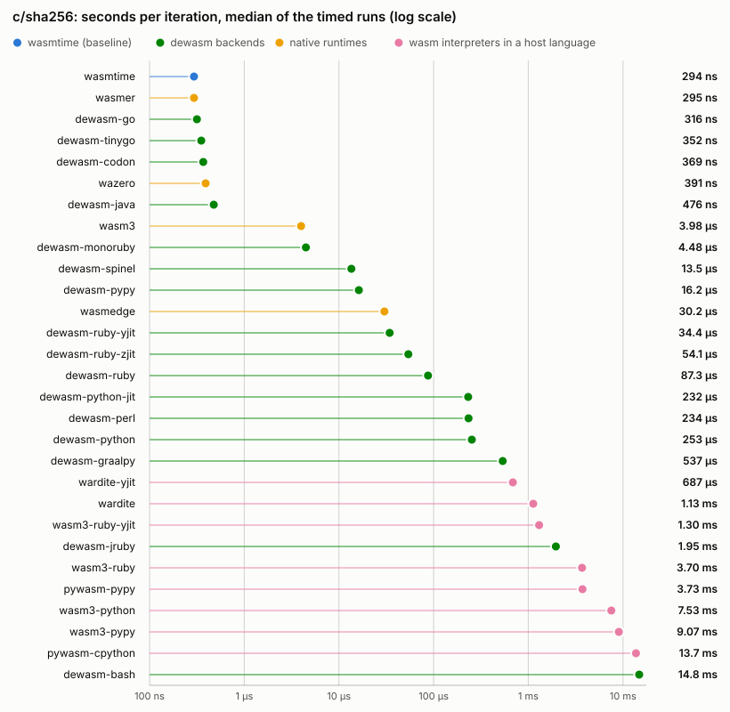
</picture>

Full numbers for <code>c/sha256</code>

| Runner | Iterations | Minimum `ns/op` | Median `ns/op` | Cold start `t(0)` | Total `t(N)` | vs. `wasmtime` | Load |
| --- | --- | --- | --- | --- | --- | --- | --- |
| `wasmtime` | 1 010 076 | 294.1 | 294.3 | 5.5 ms | 302.6 ms | 1.00x | — |
| `wasmer` | 958 216 | 293.8 | 294.7 | 9.1 ms | 290.6 ms | 1.00x | — |
| `wasmedge` | 8 037 | 30139 | 30245 | 19.6 ms | 261.8 ms | 102x | — |
| `wazero` | 724 892 | 387.6 | 391.1 | 5.3 ms | 286.3 ms | 1.32x | — |
| `wasm3` | 65 536 | 3981 | 3983 | 6.8 ms | 267.7 ms | 14x | — |
| `dewasm-ruby` | 3 194 | 86596 | 87305 | 34.9 ms | 311.5 ms | 294x | — |
| `dewasm-ruby-yjit` | 8 383 | 34239 | 34372 | 37.7 ms | 324.7 ms | 116x | — |
| `dewasm-ruby-zjit` | 5 191 | 54323 | 54070 | 35.6 ms | 317.6 ms | 185x | — |
| `dewasm-monoruby` | 61 584 | 4489 | 4483 | 34.1 ms | 310.6 ms | 15x | — |
| `dewasm-jruby` | 152 | 1970299 | 1954464 | 1.32 s | 1.62 s | 6700x | — |
| `dewasm-spinel` | 24 419 | 13520 | 13540 | 2.5 ms | 332.6 ms | 46x | — |
| `dewasm-python` | 1 120 | 252085 | 253433 | 18.9 ms | 301.2 ms | 857x | — |
| `dewasm-python-jit` | 1 207 | 231396 | 231797 | 18.2 ms | 297.5 ms | 787x | — |
| `dewasm-pypy` | 11 654 | 15903 | 16228 | 39.7 ms | 225.1 ms | 54x | — |
| `dewasm-graalpy` | 423 | 531915 | 536703 | 47.9 ms | 272.9 ms | 1809x | — |
| `dewasm-perl` | 1 290 | 231520 | 234100 | 42.4 ms | 341.1 ms | 787x | — |
| `dewasm-go` | 928 418 | 315.4 | 316.1 | 2.5 ms | 295.3 ms | 1.07x | — |
| `dewasm-tinygo` | 853 026 | 352.0 | 352.1 | 1.8 ms | 302.1 ms | 1.20x | — |
| `dewasm-java` | 470 111 | 473.9 | 476.4 | 56.7 ms | 279.4 ms | 1.61x | — |
| `dewasm-codon` | 781 669 | 368.0 | 369.2 | 12.8 ms | 300.4 ms | 1.25x | — |
| `dewasm-bash` | 20 | 14810096 | 14844892 | 13.3 ms | 309.5 ms | 50359x | — |
| `wasm3-ruby` | 147 | 3676688 | 3695086 | 118.7 ms | 659.2 ms | 12502x | — |
| `wasm3-ruby-yjit` | 169 | 1302578 | 1303573 | 278.6 ms | 498.7 ms | 4429x | — |
| `wasm3-python` | 26 | 7577962 | 7534691 | 303.2 ms | 500.3 ms | 25767x | — |
| `wasm3-pypy` | 20 | 9036115 | 9068025 | 471.2 ms | 651.9 ms | 30725x | — |
| `pywasm-cpython` | 16 | 13761982 | 13732076 | 29.0 ms | 249.2 ms | 46795x | 1.2 ms |
| `pywasm-pypy` | 50 | 3699517 | 3734548 | 79.2 ms | 264.2 ms | 12579x | 5.7 ms |
| `wardite` | 254 | 1116149 | 1129725 | 59.3 ms | 342.8 ms | 3795x | 3.8 ms |
| `wardite-yjit` | 342 | 693123 | 687106 | 155.6 ms | 392.6 ms | 2357x | 39.3 ms |

#### `c/wordcount`

<picture>
  <source media="(prefers-color-scheme: dark)" srcset="figs/c-wordcount-dark.svg">
  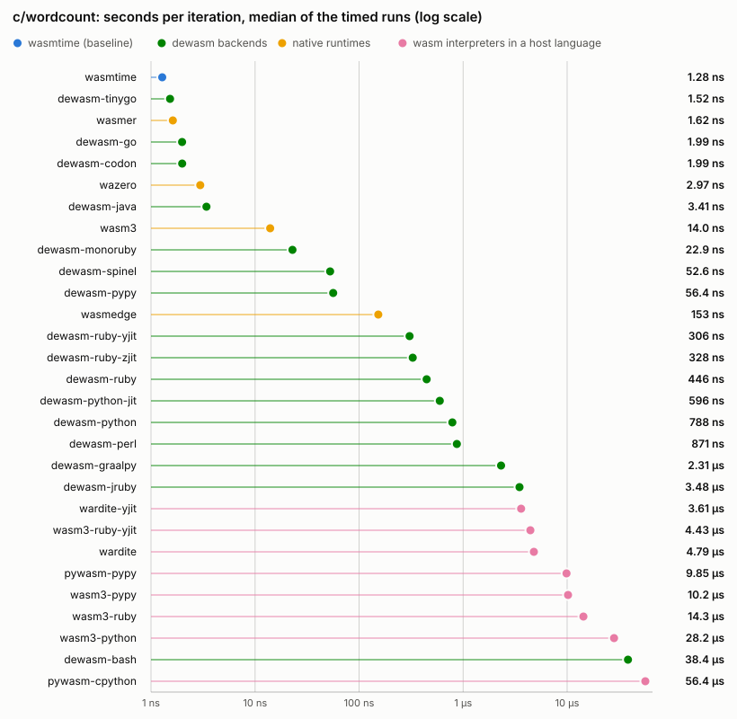
</picture>

Full numbers for <code>c/wordcount</code>

| Runner | Iterations | Minimum `ns/op` | Median `ns/op` | Cold start `t(0)` | Total `t(N)` | vs. `wasmtime` | Load |
| --- | --- | --- | --- | --- | --- | --- | --- |
| `wasmtime` | 222 738 438 | 1.27 | 1.28 | 5.2 ms | 287.3 ms | 1.00x | — |
| `wasmer` | 199 508 408 | 1.62 | 1.62 | 10.1 ms | 332.6 ms | 1.28x | — |
| `wasmedge` | 1 987 051 | 152.5 | 153.1 | 20.0 ms | 323.0 ms | 120x | — |
| `wazero` | 100 241 282 | 2.96 | 2.97 | 5.6 ms | 302.6 ms | 2.34x | — |
| `wasm3` | 24 148 376 | 14.0 | 14.0 | 6.7 ms | 343.7 ms | 11x | — |
| `dewasm-ruby` | 653 596 | 445.6 | 446.3 | 37.3 ms | 328.6 ms | 352x | — |
| `dewasm-ruby-yjit` | 776 919 | 306.1 | 305.9 | 37.0 ms | 274.8 ms | 242x | — |
| `dewasm-ruby-zjit` | 715 913 | 326.1 | 327.7 | 36.9 ms | 270.4 ms | 257x | — |
| `dewasm-monoruby` | 12 646 584 | 22.9 | 22.9 | 34.7 ms | 324.1 ms | 18x | — |
| `dewasm-jruby` | 59 481 | 3460 | 3482 | 1.36 s | 1.56 s | 2732x | — |
| `dewasm-spinel` | 5 733 405 | 52.6 | 52.6 | 2.3 ms | 304.1 ms | 42x | — |
| `dewasm-python` | 374 376 | 787.6 | 788.2 | 21.5 ms | 316.4 ms | 622x | — |
| `dewasm-python-jit` | 473 459 | 598.4 | 596.1 | 21.8 ms | 305.1 ms | 473x | — |
| `dewasm-pypy` | 4 941 370 | 56.4 | 56.4 | 44.0 ms | 322.6 ms | 45x | — |
| `dewasm-graalpy` | 100 298 | 2205 | 2315 | 56.4 ms | 277.5 ms | 1741x | — |
| `dewasm-perl` | 342 847 | 866.2 | 870.7 | 45.8 ms | 342.8 ms | 684x | — |
| `dewasm-go` | 146 311 866 | 1.93 | 1.99 | 2.4 ms | 284.1 ms | 1.52x | — |
| `dewasm-tinygo` | 197 953 137 | 1.52 | 1.52 | 1.8 ms | 303.2 ms | 1.20x | — |
| `dewasm-java` | 59 243 534 | 3.36 | 3.41 | 52.1 ms | 251.3 ms | 2.65x | — |
| `dewasm-codon` | 143 377 480 | 1.94 | 1.99 | 13.1 ms | 290.7 ms | 1.53x | — |
| `dewasm-bash` | 7 417 | 38148 | 38407 | 111.1 ms | 394.0 ms | 30124x | — |
| `wasm3-ruby` | 20 580 | 14085 | 14331 | 167.7 ms | 457.6 ms | 11123x | — |
| `wasm3-ruby-yjit` | 69 328 | 4333 | 4434 | 319.0 ms | 619.4 ms | 3422x | — |
| `wasm3-python` | 10 361 | 28039 | 28224 | 412.6 ms | 703.1 ms | 22141x | — |
| `wasm3-pypy` | 19 274 | 10339 | 10189 | 585.0 ms | 784.2 ms | 8164x | — |
| `pywasm-cpython` | 5 318 | 55931 | 56389 | 259.6 ms | 557.0 ms | 44166x | 1.3 ms |
| `pywasm-pypy` | 19 925 | 9875 | 9852 | 173.4 ms | 370.1 ms | 7798x | 6.7 ms |
| `wardite` | 65 536 | 4764 | 4788 | 74.7 ms | 387.0 ms | 3762x | 3.8 ms |
| `wardite-yjit` | 61 317 | 3562 | 3606 | 169.7 ms | 388.1 ms | 2813x | 43.0 ms |

### Application benchmarks

Seconds per **run** of a real cached program on fixed input.
Every runner executes the same work, so wall times compare directly.

#### `app/cowsay`

<picture>
  <source media="(prefers-color-scheme: dark)" srcset="figs/app-cowsay-dark.svg">
  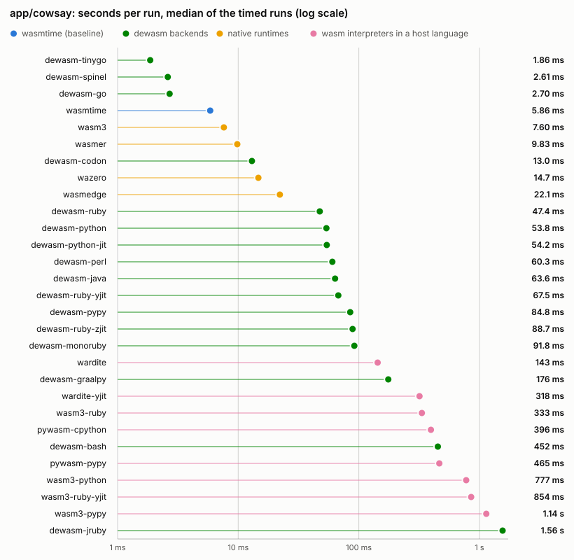
</picture>

Full numbers for <code>app/cowsay</code>

| Runner | Runs/sample | Wall time (minimum) | Wall time (median) | vs. `wasmtime` | Load |
| --- | --- | --- | --- | --- | --- |
| `wasmtime` | 38 | 5.8 ms | 5.9 ms | 1.00x | — |
| `wasmer` | 23 | 9.8 ms | 9.8 ms | 1.68x | — |
| `wasmedge` | 14 | 22.1 ms | 22.1 ms | 3.79x | — |
| `wazero` | 20 | 14.6 ms | 14.7 ms | 2.51x | — |
| `wasm3` | 37 | 7.5 ms | 7.6 ms | 1.29x | — |
| `dewasm-ruby` | 7 | 47.4 ms | 47.4 ms | 8.12x | — |
| `dewasm-ruby-yjit` | 5 | 67.3 ms | 67.5 ms | 12x | — |
| `dewasm-ruby-zjit` | 4 | 88.6 ms | 88.7 ms | 15x | — |
| `dewasm-monoruby` | 3 | 91.6 ms | 91.8 ms | 16x | — |
| `dewasm-jruby` | 1 | 1.55 s | 1.56 s | 267x | — |
| `dewasm-spinel` | 42 | 2.6 ms | 2.6 ms | 0.45x | — |
| `dewasm-python` | 6 | 53.7 ms | 53.8 ms | 9.20x | — |
| `dewasm-python-jit` | 6 | 53.8 ms | 54.2 ms | 9.22x | — |
| `dewasm-pypy` | 4 | 84.7 ms | 84.8 ms | 15x | — |
| `dewasm-graalpy` | 2 | 173.0 ms | 175.6 ms | 30x | — |
| `dewasm-perl` | 5 | 59.9 ms | 60.3 ms | 10x | — |
| `dewasm-go` | 31 | 2.7 ms | 2.7 ms | 0.46x | — |
| `dewasm-tinygo` | 64 | 1.8 ms | 1.9 ms | 0.31x | — |
| `dewasm-java` | 5 | 63.2 ms | 63.6 ms | 11x | — |
| `dewasm-codon` | 19 | 12.9 ms | 13.0 ms | 2.21x | — |
| `dewasm-bash` | 1 | 451.5 ms | 451.8 ms | 77x | — |
| `wasm3-ruby` | 1 | 332.0 ms | 333.4 ms | 57x | — |
| `wasm3-ruby-yjit` | 1 | 851.9 ms | 853.6 ms | 146x | — |
| `wasm3-python` | 1 | 775.9 ms | 776.8 ms | 133x | — |
| `wasm3-pypy` | 1 | 1.13 s | 1.14 s | 194x | — |
| `pywasm-cpython` | 1 | 395.9 ms | 396.1 ms | 68x | 19.3 ms |
| `pywasm-pypy` | 1 | 459.2 ms | 465.1 ms | 79x | 115.1 ms |
| `wardite` | 3 | 143.1 ms | 143.2 ms | 25x | 20.7 ms |
| `wardite-yjit` | 1 | 315.3 ms | 318.4 ms | 54x | 87.1 ms |

#### `app/sqlite3_query`

<picture>
  <source media="(prefers-color-scheme: dark)" srcset="figs/app-sqlite3-query-dark.svg">
  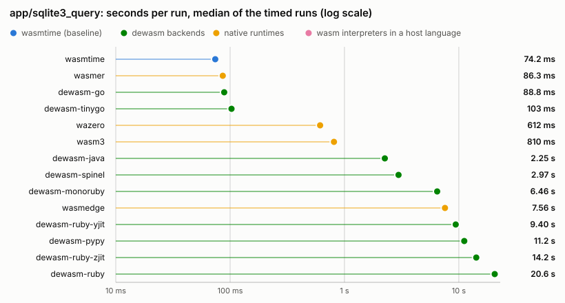
</picture>

Full numbers for <code>app/sqlite3_query</code>

| Runner | Runs/sample | Wall time (minimum) | Wall time (median) | vs. `wasmtime` | Load |
| --- | --- | --- | --- | --- | --- |
| `wasmtime` | 4 | 73.9 ms | 74.2 ms | 1.00x | — |
| `wasmer` | 4 | 85.1 ms | 86.3 ms | 1.15x | — |
| `wasmedge` | 1 | 7.56 s | 7.56 s | 102x | — |
| `wazero` | 1 | 609.8 ms | 612.4 ms | 8.25x | — |
| `wasm3` | 1 | 808.2 ms | 809.6 ms | 11x | — |
| `dewasm-ruby` | 1 | 20.56 s | 20.60 s | 278x | — |
| `dewasm-ruby-yjit` | 1 | 9.37 s | 9.40 s | 127x | — |
| `dewasm-ruby-zjit` | 1 | 14.05 s | 14.20 s | 190x | — |
| `dewasm-monoruby` | 1 | 6.43 s | 6.46 s | 87x | — |
| `dewasm-spinel` | 1 | 2.97 s | 2.97 s | 40x | — |
| `dewasm-pypy` | 1 | 11.12 s | 11.16 s | 150x | — |
| `dewasm-go` | 3 | 88.5 ms | 88.8 ms | 1.20x | — |
| `dewasm-tinygo` | 3 | 102.6 ms | 102.9 ms | 1.39x | — |
| `dewasm-java` | 1 | 2.24 s | 2.25 s | 30x | — |

#### `app/sqlite3_mod_query`

<picture>
  <source media="(prefers-color-scheme: dark)" srcset="figs/app-sqlite3-mod-query-dark.svg">
  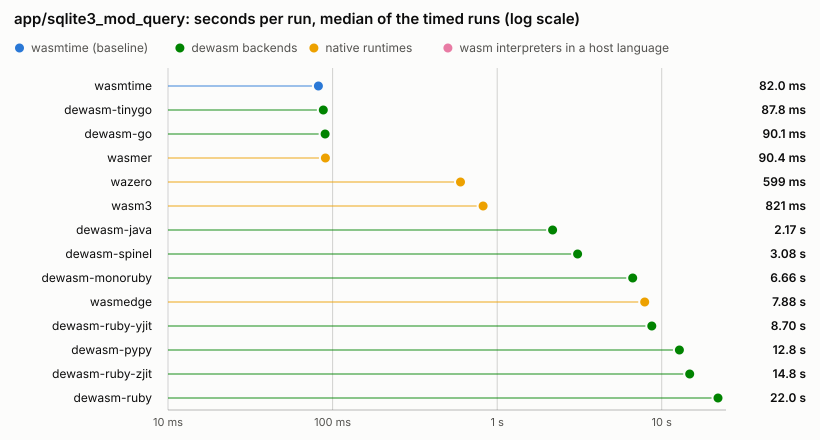
</picture>

Full numbers for <code>app/sqlite3_mod_query</code>

| Runner | Runs/sample | Wall time (minimum) | Wall time (median) | vs. `wasmtime` | Load |
| --- | --- | --- | --- | --- | --- |
| `wasmtime` | 4 | 81.7 ms | 82.0 ms | 1.00x | — |
| `wasmer` | 3 | 90.3 ms | 90.4 ms | 1.10x | — |
| `wasmedge` | 1 | 7.88 s | 7.88 s | 96x | — |
| `wazero` | 1 | 598.6 ms | 598.9 ms | 7.33x | — |
| `wasm3` | 1 | 742.8 ms | 821.4 ms | 9.09x | — |
| `dewasm-ruby` | 1 | 21.96 s | 21.97 s | 269x | — |
| `dewasm-ruby-yjit` | 1 | 8.67 s | 8.70 s | 106x | — |
| `dewasm-ruby-zjit` | 1 | 14.69 s | 14.79 s | 180x | — |
| `dewasm-monoruby` | 1 | 6.60 s | 6.66 s | 81x | — |
| `dewasm-spinel` | 1 | 3.08 s | 3.08 s | 38x | — |
| `dewasm-pypy` | 1 | 12.80 s | 12.81 s | 157x | — |
| `dewasm-go` | 3 | 89.7 ms | 90.1 ms | 1.10x | — |
| `dewasm-tinygo` | 4 | 87.7 ms | 87.8 ms | 1.07x | — |
| `dewasm-java` | 1 | 2.15 s | 2.17 s | 26x | — |

#### `app/minigzip`

<picture>
  <source media="(prefers-color-scheme: dark)" srcset="figs/app-minigzip-dark.svg">
  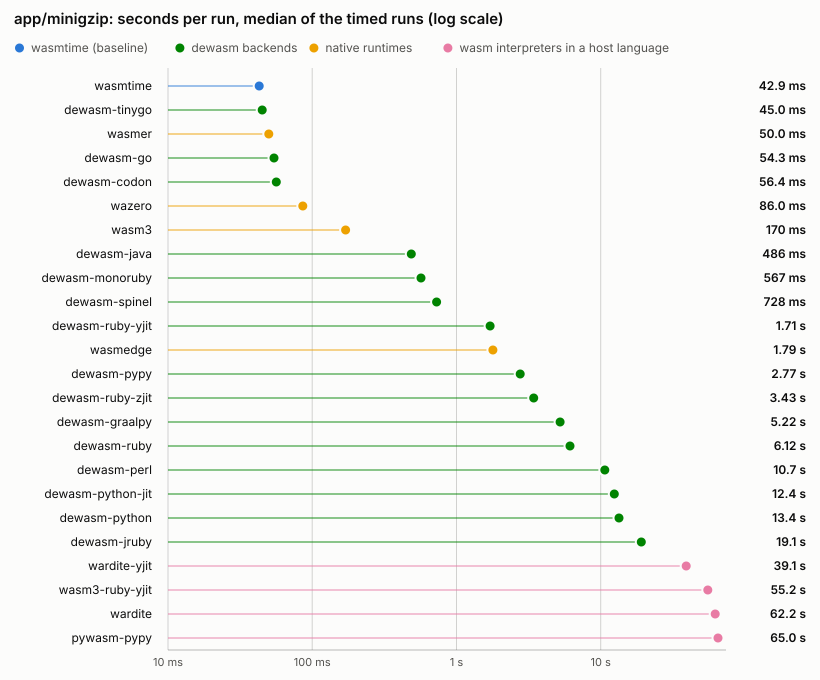
</picture>

Full numbers for <code>app/minigzip</code>

| Runner | Runs/sample | Wall time (minimum) | Wall time (median) | vs. `wasmtime` | Load |
| --- | --- | --- | --- | --- | --- |
| `wasmtime` | 7 | 42.9 ms | 42.9 ms | 1.00x | — |
| `wasmer` | 6 | 50.0 ms | 50.0 ms | 1.17x | — |
| `wasmedge` | 1 | 1.79 s | 1.79 s | 42x | — |
| `wazero` | 4 | 85.3 ms | 86.0 ms | 1.99x | — |
| `wasm3` | 2 | 169.9 ms | 170.4 ms | 3.96x | — |
| `dewasm-ruby` | 1 | 6.11 s | 6.12 s | 143x | — |
| `dewasm-ruby-yjit` | 1 | 1.70 s | 1.71 s | 40x | — |
| `dewasm-ruby-zjit` | 1 | 3.40 s | 3.43 s | 79x | — |
| `dewasm-monoruby` | 1 | 560.2 ms | 567.2 ms | 13x | — |
| `dewasm-jruby` | 1 | 18.31 s | 19.09 s | 427x | — |
| `dewasm-spinel` | 1 | 723.7 ms | 727.6 ms | 17x | — |
| `dewasm-python` | 1 | 13.36 s | 13.39 s | 312x | — |
| `dewasm-python-jit` | 1 | 12.41 s | 12.42 s | 289x | — |
| `dewasm-pypy` | 1 | 2.75 s | 2.77 s | 64x | — |
| `dewasm-graalpy` | 1 | 4.79 s | 5.22 s | 112x | — |
| `dewasm-perl` | 1 | 10.47 s | 10.67 s | 244x | — |
| `dewasm-go` | 6 | 53.7 ms | 54.3 ms | 1.25x | — |
| `dewasm-tinygo` | 7 | 44.2 ms | 45.0 ms | 1.03x | — |
| `dewasm-java` | 1 | 477.6 ms | 486.4 ms | 11x | — |
| `dewasm-codon` | 5 | 56.2 ms | 56.4 ms | 1.31x | — |
| `wasm3-ruby-yjit` | 1 | 54.99 s | 55.19 s | 1282x | — |
| `pywasm-pypy` | 1 | 63.33 s | 64.99 s | 1477x | 310.7 ms |
| `wardite` | 1 | 62.08 s | 62.20 s | 1448x | 62.2 ms |
| `wardite-yjit` | 1 | 38.80 s | 39.14 s | 905x | 124.6 ms |

## Not measured

Every pair the suite did not measure, and why.
A missing runner or an unbuilt module is stated here rather than left as a gap in the tables above.
Kind classifies the gap:

- `cost`: runs correctly, but too slowly to keep in the suite;
- `capability`: the runner cannot execute the workload;
- `setup`: this host lacks the runner or the built module;
- `time limit`: the build or the run went past its time limit.

| Workload | Runner | Kind | Reason |
| --- | --- | --- | --- |
| `wat/eh_throw` | `wazero` | `capability` | `wazero` rejects the tag section: its exception-handling feature is not enabled |
| `wat/eh_throw` | `wasm3` | `capability` | wasm3 fails to load the module: the tag section is unknown to it |
| `wat/eh_throw` | `dewasm-bash` | `capability` | the Bash backend has no exception-handling lowering and rejects the module at conversion time |
| `wat/eh_throw` | `wasm3-ruby` | `capability` | the converted wasm3 fails to load the module like the native one: the tag section is unknown to it |
| `wat/eh_throw` | `wasm3-ruby-yjit` | `capability` | the converted wasm3 fails to load the module like the native one: the tag section is unknown to it |
| `wat/eh_throw` | `wasm3-python` | `capability` | the converted wasm3 fails to load the module like the native one: the tag section is unknown to it |
| `wat/eh_throw` | `wasm3-pypy` | `capability` | the converted wasm3 fails to load the module like the native one: the tag section is unknown to it |
| `wat/eh_throw` | `pywasm-cpython` | `capability` | `pywasm` has no exception-handling opcodes and fails decoding the module |
| `wat/eh_throw` | `pywasm-pypy` | `capability` | `pywasm` has no exception-handling opcodes and fails decoding the module |
| `wat/eh_try` | `wazero` | `capability` | `wazero` rejects the tag section: its exception-handling feature is not enabled |
| `wat/eh_try` | `wasm3` | `capability` | wasm3 fails to load the module: the tag section is unknown to it |
| `wat/eh_try` | `dewasm-bash` | `capability` | the Bash backend has no exception-handling lowering and rejects the module at conversion time |
| `wat/eh_try` | `wasm3-ruby` | `capability` | the converted wasm3 fails to load the module like the native one: the tag section is unknown to it |
| `wat/eh_try` | `wasm3-ruby-yjit` | `capability` | the converted wasm3 fails to load the module like the native one: the tag section is unknown to it |
| `wat/eh_try` | `wasm3-python` | `capability` | the converted wasm3 fails to load the module like the native one: the tag section is unknown to it |
| `wat/eh_try` | `wasm3-pypy` | `capability` | the converted wasm3 fails to load the module like the native one: the tag section is unknown to it |
| `wat/eh_try` | `pywasm-cpython` | `capability` | `pywasm` has no exception-handling opcodes and fails decoding the module |
| `wat/eh_try` | `pywasm-pypy` | `capability` | `pywasm` has no exception-handling opcodes and fails decoding the module |
| `wat/tail_call` | `wasmer` | `capability` | `wasmer` rejects the module: tail-call support is not enabled |
| `wat/tail_call` | `wazero` | `capability` | `wazero` rejects `return_call`: its tail-call feature is not enabled |
| `wat/tail_call` | `pywasm-cpython` | `capability` | `pywasm` has no tail-call opcodes and fails decoding `return_call` |
| `wat/tail_call` | `pywasm-pypy` | `capability` | `pywasm` has no tail-call opcodes and fails decoding `return_call` |
| `wat/tail_call` | `wardite` | `capability` | `wardite` rejects `return_call` as an unsupported instruction |
| `wat/tail_call` | `wardite-yjit` | `capability` | `wardite` rejects `return_call` as an unsupported instruction |
| `app/sqlite3_query` | `dewasm-jruby` | `cost` | JRuby runs this program correctly but too slowly to keep: the largest generated methods exceed the JVM's per-method bytecode limit and never JIT (issue #206) |
| `app/sqlite3_query` | `dewasm-python` | `cost` | `dewasm-python` runs this program correctly but too slowly to keep; it stays measured on the other app cases and the microbenchmarks |
| `app/sqlite3_query` | `dewasm-python-jit` | `cost` | the JIT-enabled CPython runs this program correctly but in the same cost class as plain CPython, so it is excluded for the same reason as `dewasm-python` |
| `app/sqlite3_query` | `dewasm-graalpy` | `cost` | GraalPy runs this program correctly but no faster than CPython: the engine's JIT does not reach the largest generated methods |
| `app/sqlite3_query` | `dewasm-perl` | `cost` | `dewasm-perl` runs this program correctly but too slowly to keep; it stays measured on the other app cases and the microbenchmarks |
| `app/sqlite3_query` | `dewasm-codon` | `cost` | the artifact build does not finish in a practical time: `codon build -release` does not get past Codon's capture analysis on the sqlite3 shell's largest generated functions |
| `app/sqlite3_query` | `dewasm-bash` | `cost` | Bash executes compute workloads orders of magnitude slower than Wasmtime, so the query script does not finish in a practical time |
| `app/sqlite3_query` | `wasm3-ruby` | `cost` | the converted wasm3 runs this program correctly but too slowly to keep on any of the four wasm3-* runners |
| `app/sqlite3_query` | `wasm3-ruby-yjit` | `cost` | the converted wasm3 runs this program correctly but too slowly to keep on any of the four wasm3-* runners |
| `app/sqlite3_query` | `wasm3-python` | `cost` | the converted wasm3 runs this program correctly but too slowly to keep on any of the four wasm3-* runners |
| `app/sqlite3_query` | `wasm3-pypy` | `cost` | the converted wasm3 runs this program correctly but too slowly to keep on any of the four wasm3-* runners |
| `app/sqlite3_query` | `pywasm-cpython` | `cost` | `pywasm` runs this program correctly but too slowly for the query script |
| `app/sqlite3_query` | `pywasm-pypy` | `cost` | `pywasm` runs this program correctly but too slowly for the query script |
| `app/sqlite3_query` | `wardite` | `cost` | `wardite` runs this program correctly but too slowly for the query script |
| `app/sqlite3_query` | `wardite-yjit` | `cost` | `wardite` runs this program correctly but too slowly for the query script |
| `app/sqlite3_mod_query` | `dewasm-jruby` | `cost` | JRuby runs this program correctly but too slowly to keep: the largest generated methods exceed the JVM's per-method bytecode limit and never JIT (issue #206) |
| `app/sqlite3_mod_query` | `dewasm-python` | `cost` | `dewasm-python` runs this program correctly but too slowly to keep; it stays measured on the other app cases and the microbenchmarks |
| `app/sqlite3_mod_query` | `dewasm-python-jit` | `cost` | the JIT-enabled CPython runs this program correctly but in the same cost class as plain CPython, so it is excluded for the same reason as `dewasm-python` |
| `app/sqlite3_mod_query` | `dewasm-graalpy` | `cost` | GraalPy runs this program correctly but no faster than CPython: the engine's JIT does not reach the largest generated methods |
| `app/sqlite3_mod_query` | `dewasm-perl` | `cost` | `dewasm-perl` runs this program correctly but too slowly to keep; it stays measured on the other app cases and the microbenchmarks |
| `app/sqlite3_mod_query` | `dewasm-codon` | `cost` | the artifact build does not finish in a practical time: `codon build -release` does not get past Codon's capture analysis on the sqlite3 shell's largest generated functions |
| `app/sqlite3_mod_query` | `dewasm-bash` | `cost` | Bash executes compute workloads orders of magnitude slower than Wasmtime, so the query script does not finish in a practical time |
| `app/sqlite3_mod_query` | `wasm3-ruby` | `cost` | the converted wasm3 runs this program correctly but too slowly to keep on any of the four wasm3-* runners |
| `app/sqlite3_mod_query` | `wasm3-ruby-yjit` | `cost` | the converted wasm3 runs this program correctly but too slowly to keep on any of the four wasm3-* runners |
| `app/sqlite3_mod_query` | `wasm3-python` | `cost` | the converted wasm3 runs this program correctly but too slowly to keep on any of the four wasm3-* runners |
| `app/sqlite3_mod_query` | `wasm3-pypy` | `cost` | the converted wasm3 runs this program correctly but too slowly to keep on any of the four wasm3-* runners |
| `app/sqlite3_mod_query` | `pywasm-cpython` | `cost` | `pywasm` runs this program correctly but too slowly for the query script |
| `app/sqlite3_mod_query` | `pywasm-pypy` | `cost` | `pywasm` runs this program correctly but too slowly for the query script |
| `app/sqlite3_mod_query` | `wardite` | `cost` | `wardite` runs this program correctly but too slowly for the query script |
| `app/sqlite3_mod_query` | `wardite-yjit` | `cost` | `wardite` runs this program correctly but too slowly for the query script |
| `app/minigzip` | `dewasm-bash` | `cost` | Bash compresses this workload's input too slowly to finish in a practical time |
| `app/minigzip` | `wasm3-ruby` | `cost` | the converted Wasm3 compresses the input correctly but too slowly to keep on Ruby, PyPy and CPython; `wasm3-ruby-yjit` stays measured |
| `app/minigzip` | `wasm3-python` | `cost` | the converted Wasm3 compresses the input correctly but too slowly to keep on Ruby, PyPy and CPython; `wasm3-ruby-yjit` stays measured |
| `app/minigzip` | `wasm3-pypy` | `cost` | the converted Wasm3 compresses the input correctly but too slowly to keep on Ruby, PyPy and CPython; `wasm3-ruby-yjit` stays measured |
| `app/minigzip` | `pywasm-cpython` | `cost` | `pywasm` under CPython compresses this workload's input too slowly to finish in a practical time |

